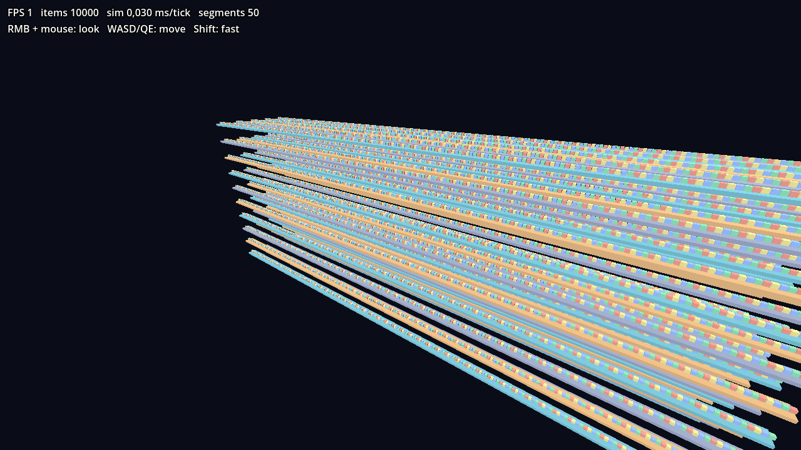

# Prototype P1: belt simulation and rendering

Status: done (2026-11-19). Validates [ADR 0001](../adr/0001-engine.md) and [ADR 0002](../adr/0002-deterministic-simulation-core.md) for the belt case. It is a throwaway-quality prototype: no player, no machines, no save, no input commands.



## What it contains
| Path | What |
| --- | --- |
| `src/Starfoundry.Sim` | Engine-independent .NET 8 library: belts, splitters, merges, sources, sinks, checksum |
| `tests/Starfoundry.Sim.Tests` | 14 xunit tests |
| `tools/Starfoundry.Bench` | Headless simulation benchmark |
| `game/` | Godot 4.7.2 (C#) project rendering the simulation with two MultiMeshes |

## Model
- 30 ticks per second, integer positions: 240 sub-units per cell, items kept at least 60 sub-units apart (4 per cell).
- Tiers by movement per tick: Mk1 8, Mk2 20, Mk3 48, giving 4, 10 and 24 items per second.
- Each segment stores items in a ring buffer ordered front to back. The front item hands over to up to two outputs (round-robin splitter); a blocked output makes items queue and a full dead end loses nothing.
- Segments are processed downstream first so space freed in a tick is used in the same tick. Sources insert exactly one spacing behind the tail so a saturated belt stays perfectly packed. The carried-over sub-tick distance is preserved across segment joins, so chained belts keep full throughput.

## Fair merge
A segment fed by several belts rotates priority round-robin: after an input hands over an item, the next input in the list has top priority. An input yields only to a higher-priority input that still has to move this tick and has an item waiting at its end aimed at the same segment, so an idle or slow input never wastes capacity. The result is max-min fair and does not depend on segment creation order. Tests: two and three saturated inputs split evenly (within 2 to 3 items per minute), a slow Mk1 input keeps its full 4 items per second while a fast one takes the rest of a Mk3 output, and swapping the connection order gives the same split.

## Tests (all passing, 18)
Single-item travel time, saturated throughput per tier (within 3 percent), throughput through chained segments, blocked belts keep spacing and lose nothing, item conservation on every tick, fair splitting, a splitter with one blocked output, merges (conservation, even split, max-min fairness, order independence), determinism (same scenario, same checksum), cycles, and invalid wiring.

## Results
Machine: Ryzen 9 7950X, RTX 4080 SUPER, Windows 11, Godot 4.7.2 Forward+, vsync off. The recommended spec in the specs is weaker (RTX 3060 Ti), so treat the rendering numbers as an upper bound.

| Scenario | Items | Sim avg per tick | Godot avg frame | p99 frame |
| --- | --- | --- | --- | --- |
| 50 belts x 50 cells | 10,000 | 0.04 to 0.07 ms | 0.84 ms (about 1,190 FPS) | 1.3 ms |
| 500 belts x 50 cells | 100,000 | 0.17 to 0.54 ms | 7.4 ms (about 135 FPS) | 22 ms |

ADR 0001 success criterion (10,000 belt items rendered through MultiMesh at 60 FPS): **met with a large margin** on this machine. The headless benchmark shows the simulation itself is far below the 5 ms per tick target at 10,000 items and well below the 33 ms budget at 100,000.

## What limited the 100,000 case
The simulation is not the bottleneck. Each frame the C# loop rewrites a 100,000 x 16 float buffer and uploads it (about 6.4 MB), and the p99 spikes come from that. Likely fixes when it matters: upload only visible or changed items, store positions on the GPU and move items in a vertex shader from segment data, and cull by build volume.

## Known limitations
- Merges are fair (see below) but only between belts; there is no priority input or filter yet.
- A waiting item entering a merge may skip ahead by up to one tick of travel (visible only as a small step), which keeps a saturated merge at the full output rate.
- Straight, axis-aligned segments only; corners are segment joins, with no curved visuals or slopes.
- No items on the move between ticks other than linear extrapolation in the renderer.
- No commands layer, save format or networking yet.

## Run it
```powershell
dotnet test
dotnet run -c Release --project tools/Starfoundry.Bench
dotnet build game -c Debug
```
Then open `game/` in Godot 4.7.2 (Mono) and press F5, or run the game folder from the command line with `--bench` after `--` for the frame-time benchmark. Controls: hold right mouse to look, WASD and QE to move, Shift for speed.
