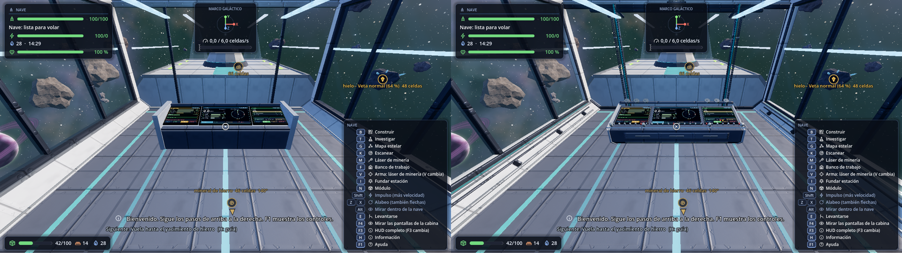
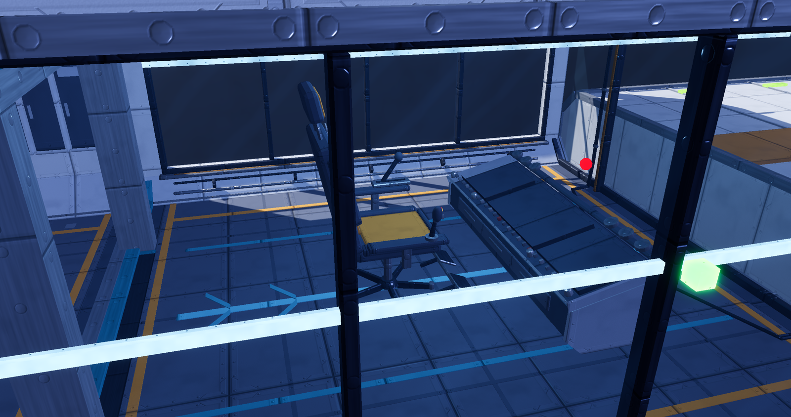

# Prototype: Blender-authored module detail (pilot: the starter cockpit)

Status: pilot done (2026-11-24), behind a flag; the procedural cockpit is still the default. Section 5 of the [retrospective](../retrospective-2026-11-24.md) is the plan this follows. Everything here is *measured* unless marked *proposal*.

## What it is
The detail of one module (the console, the pilot seat with stick, throttle and pedals, the windscreen and window frames, an overhead panel, cable runs, the glass and the emissive marks) is built in Blender by a script, exported as glTF 2.0 (`game/assets/blender/cockpit_wide.glb`) and put in the cockpit module at run time. The *shell* (hull, floor, joints, nose, chamfers) and the *collision* stay in code: `HullProfile` is still the single source of the section and `HullProfile.Fixture` is still what is solid. The three displays are still Godot `SubViewport` quads placed by `CockpitScreenLayout`; the Blender console only gives them recessed wells.





## Running it
```powershell
# rebuild the glb (headless Blender, about 4 s); optional workbench previews of the geometry
pwsh tools/blender/build.ps1 [-Preview <dir>]

# play with it: the flag for one run, or blender_cockpit=true in user://settings.cfg (the persisted debug option)
godot --path game -- --blender-cockpit            # --blender-cockpit=off forces the procedural cockpit

# compare
godot --path game --resolution 1920x1080 -- --cockpit-shot=out/cp --cockpit-size=1920x1080 [--blender-cockpit]
godot --path game -- --flight-shot=out/fl [--blender-cockpit]
godot --path game -- --walk-shot=out/wk [--blender-cockpit]
godot --path game res://Gallery.tscn -- --focus=ship-starter --at=4,1.8,4 --angle=90 --pitch=8 --dist=16 --fov=35 --shot=out/g.png [--blender-cockpit]
godot --path game --resolution 1280x720 -- --cockpit-shot=x --cockpit-bench [--blender-cockpit]   # COCKPITBENCH frame-time line
```
Needs Blender 4.2 or newer (tested with 5.3; `$env:BLENDER` points to `blender.exe`). Nothing else: no add-on, no network. If the BlenderMCP add-on is connected the owner can import the `.glb` into the open Blender to look at it (the add-on's socket listens only after Connect is clicked in its sidebar tab); the pilot did not need it.

When the shell numbers change (`CockpitShell`, `HullProfile`): `STARFOUNDRY_UPDATE_SHELL=1 dotnet test --filter BlenderPipelineTests` rewrites `tools/blender/shell.json`, then rebuild the glb and commit both. The tests fail until you do.

## Folder layout
| Path | What |
| --- | --- |
| `src/Starfoundry.Ui/CockpitShell.cs` | The engine-free numbers (deck origin, tilt, squeeze, screen rectangles, the starter ship's mask) and `ToJson()`. `CockpitScreenLayout` in the game reads its constants from here. |
| `tools/blender/shell.json` | Generated from `CockpitShell`: module size, the starter section and liner, the windscreen, the side-window band, the seat and console footprints, the deck frame as a matrix, the screen corners in module space. |
| `tools/blender/sfgeo.py` | The geometry kit: primitives with bevels, vertex colours, a port of `FaceUv` (framed UVs in module units), triangulation and the glTF-ready object. Authored in the game frame and converted at vertex creation. |
| `tools/blender/cockpit.py` | The cockpit generator: console, seat, frames, details; exports the `.glb`. |
| `tools/blender/preview.py`, `build.ps1` | Workbench previews, the runner. |
| `game/assets/blender/cockpit_wide.glb` | The export (a committed binary, about 1 MB). No `.blend` is committed. |
| `game/BlenderCockpit.cs` | The loader and the name-to-material mapping. |
| `tests/Starfoundry.Sim.Tests/BlenderPipelineTests.cs` | shell.json fresh, glb built from it, node names, attributes, bounds, triangle budget. |

## Conventions
- **Frame and pivot.** One glb per module shell, authored in the module frame: X right, Y up, Z back (the front of a ship is z = 0), 1 unit = 1 cell, origin at the module's minimum corner (the same origin as `ModuleModels`). The glTF carries identity node transforms; every vertex is already in module space, so placing it is `AddChild` on the module node. Blender is Z up; `sfgeo.py` converts at vertex creation (`G2B`) and the exporter converts back (`+Y up`), so the numbers in the file are the game's.
- **Grid.** Panels follow the module grid: faces are framed like `FaceUv` (a whole number of 1-cell panels per face, the longer side is u), so the plating texture lines up with the procedural hull next to it.
- **Names** (the contract with `BlenderCockpit.cs`): `*_Hull` is plating (`Materials.ModuleHull`), `*_Struct` is structural metal (`Materials.ModuleStruct`), `Glass` is `Materials.Glass` (no shadow), `Glow_Amber|Green|Cyan|Red|Warm` are the emissive marks (one node per colour; the game names the instances `GlowDash`, so `Models.Animate` treats them like the old displays' lamps). The empty `Seat` groups the seat parts and keeps its name: `StationView.SetSeatVisible` hides it while seated.
- **Vertex colour** is the role colour coding (the palette of `ModuleModels`: Dark, Steel, Panel, the cockpit's cyan). The colour (1, 0, 1) is a tag: the game paints it with the structure's trim colour, so variants 0 to 2 keep their blue, teal and orange.
- **Collision rule.** Nothing the body can touch is added beyond `HullProfile.Fixture`: the console stays inside `ConsoleX0..X1 x ConsoleZ0..Z1`, the seat inside `SeatX0..X1 x SeatZ0..Z1` (the pedals and the sill detail are the only parts that stray, by a hand). Everything else is wall-mounted and at most about 0.1 cell deep (window frames, conduits on the chamfer slope, ceiling tray). No collision nodes are exported (`-colonly` suffixes were not needed).
- **Screens.** The wells are cut to the rectangles of `CockpitScreenLayout` (the screen corners come from shell.json after the tilt and the squeeze); the quads and the seated eye are unchanged. When the Blender console is present `CockpitDisplays` skips its plain bezel boxes.
- **Scope.** The glb is made for the starter ship's cockpit shell (a pod in front, a module behind and above, so a flat windscreen and a solid roof): `CockpitShell.IsStarterShell(mask)`. Other cockpit shells (the nose with a glass roof, a cockpit with a neighbour at the side) take the procedural cockpit. Covering them means more glb files from the same generator.
- **Licences.** All geometry is generated by our own scripts: no downloaded asset, no texture, nothing from another game. Blender is GPL, but its output (the glb) is not encumbered; the exporter is Blender's built-in one.
- **Runtime load** (`GltfDocument`, no editor import): a fresh checkout runs it with no `.import` files or `.godot` cache. Reading `res://...glb` as bytes works in a checkout and in the editor; an exported build needs the file in the export filter or next to the executable (the loader also looks in `assets/blender/` beside the exe). The pilot did not touch `export_presets.cfg`. Godot also imports the glb headless without trouble (`godot --headless --import`: 5.8 s for all 16 glb files of the project on a cold cache).

## Measured results
Same machine (RTX 4080 Super), Godot 4.7.2 Mono, Debug build, the structures campaign, the starter ship seated, looking at the console; `--cockpit-bench` (300 frames after 70, vertical sync off, three runs each).

| | Procedural | Blender |
| --- | --- | --- |
| Replaced parts: triangles | about 3,500 (inferred from the frame's primitive count) | 8,122 in 13 meshes (console 328+910, details 164+2,664, frames 1,324, seat 1,488+1,068, glass 44, emissive 132) |
| File / generator | none (C# code) | 1.05 MB glb; 4 s to rebuild; 40 kB of generator source (750 lines of Python) |
| First use (parse, mesh rebuild, materials) | none | 72 to 84 ms once per run (13 meshes cached per trim colour afterwards) |
| Frame time, 1280x720 | 4.8 to 5.0 ms average (p95 5.4 to 6.0) | 5.0 to 5.1 (p95 6.0 to 6.4) |
| Frame time, 1920x1080 | 4.9 to 5.4 | 4.8 to 5.3 |
| Render GPU time, 720p / 1080p | 0.33 / 0.58 ms | 0.34 / 0.60 ms |
| Draw calls, objects | 416, 2,150 | 411, 2,145 |
| Primitives in the frame | 39,844 | 44,500 |
| Video memory | 162 / 216 MB | 163 / 217 MB |

The frame is bound by game logic on the main thread (about 5 ms either way); the difference is inside the run-to-run noise. Shots at 1280x720 and 1920x1080 (cockpit, flight, walk) and one 10-second orbit movie of each version were produced; the images in this folder are the 1280x720 comparison and a close view.

## What the images show
Better, clearly, at the distances the player sees: the console has recessed wells with chamfered rims, a coaming with six gauge pods, 24 toggles with a row of indicator marks, rotary knobs, access hatches, vents and a role-colour stripe; the seat is a real swivel chair (five-star base, gas lift, bolsters, reclined back with lumbar pad, headrest on posts, harness, armrests, a stick with a grip and buttons, a throttle with a slot and detent marks, pedals); the windscreen and the side windows have mullions and thin bevelled frames, the glass is a separate node, there is an overhead panel with switches, a cable tray, warm light strips, conduits and cable bundles. The silhouette gains from bevels (every chair part and the console edge catch light), which the procedural builder cannot make.

Honest limits:
- The gain is mostly *detail and bevels*, which a bevel operation added to `Models.Mb` could also deliver in C#. What Blender added that C# lacks: bevels and an exporter for free, a real viewer (workbench previews in four seconds), and the option of GUI sculpting. The pilot did not use the GUI (no live MCP link): the model was written as a Python script, so the authoring loop is the same as C#'s (edit, rebuild, look), only with better primitives.
- The seat from behind is a flat dark slab and the console body is plain; a human modeller would add more. Triangle counts are modest but 2.3 times the procedural parts.
- The file is generated from numbers; it is not hand-made art. It can be hand-edited later in Blender only if the script stops being the source of truth.

## What was slower or harder
- Two languages and a contract: C# numbers to JSON, Python to glTF, C# to materials. The stale-file test (`shell.json`, plus a SHA-1 stamp of it inside the glb) covers the first link; the node names and the material mapping are conventions a test only partly checks.
- A port of `FaceUv` was needed in Python (about 90 lines) so the textures frame like the procedural hull; vertex colours had to be float and active (`export_vertex_color='ACTIVE'`), UV v is flipped by the exporter, the `Seat` group has to keep its name for the seat toggle, and tangents come from the exporter (they differ in the last bits between runs, so the binary is not byte-identical although the geometry is; sets of mesh elements had to be sorted to make the geometry itself deterministic).
- Only one shell is covered. The runtime reads the file itself (`GltfDocument`) and rebuilds each mesh once per trim colour, because the accent tag has to be painted.
- Binary in git: 1 MB per module per regeneration. Fine for a handful of modules; for many, drop the tangents (a quarter of the file, Godot can generate them), use Git LFS, or build the glb in CI instead of committing it (needs Blender in the job).
- No automated look check: the shots are compared by eye.

## Cost per module and recommendation
The pilot built the reusable kit (`sfgeo.py`, loader, shell JSON, tests, bench mode, this document) and then the cockpit. A further module with the same kit is a script of 300 to 500 lines plus a shell JSON section: *proposal*, half a day to a day each including the look checks, against about the same for procedural C# of the same level of detail.

**Recommendation: go, for the hero modules, with conditions.**
1. Keep the shell and the collision in code; Blender does the detail, parameterised by a generated JSON (the test that fails on a stale file is the safety net).
2. Extend in this order: the cockpit shells with a nose and a glass roof (the same generator, other canopy), the engine (nozzles and machinery), the reactor vessel, then machines. Do not convert small repeated parts (frames, joints) or anything instanced thousands of times.
3. Use the MCP (when the owner connects it) for design exploration on the generated file, and fold what is liked back into the script, so the script stays the source of truth.
4. Decide the binary policy before the second module (tangent-free export or LFS), and add Blender to CI only if a stale-glb check by stamp is not enough.
5. Make `--blender-cockpit` the default only after a hand-test by the owner (flying, walking, sitting down, all three trim colours) and an export-build check of the file lookup.
