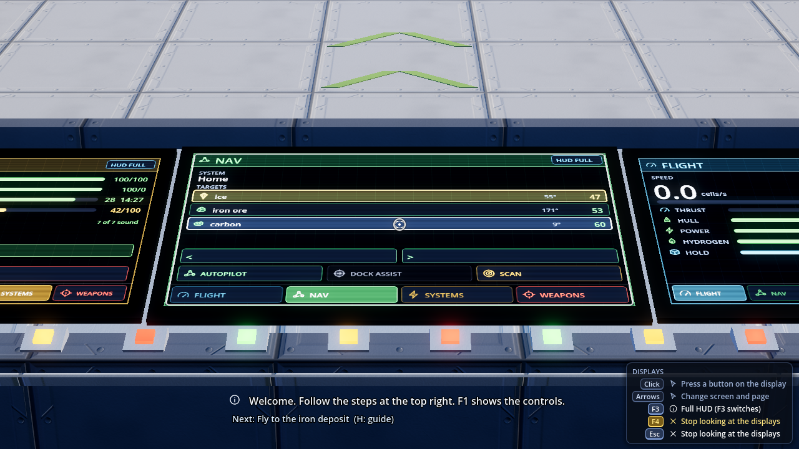

# Cockpit displays, HUD modes and smoother motion

Status: prototype, checked by unit tests and headless screenshots only. Nobody has used it by hand; the screenshots are the only look at it so far.

The pilot's console had three decorative screens. They are now real displays: the flight information that the outside HUD draws is also drawn on them, they react to the crosshair, and the outside HUD can be turned down so the cockpit carries it.

## The displays

Three screens, pilot's left to right. Each shows one of four pages; one page is always off, and picking a page that is on another screen swaps the two (`CockpitPages`, engine-free).

| Page | Shows |
|---|---|
| Flight | the speed (large), speed bar, boost chip, thrust, hull, power, hydrogen with the time it lasts, hold; the galactic frame (the HUD gizmo, bigger) with the velocity dot in the ship's own axes: centre = nose, rim = 90 degrees, hollow dot = drifting backwards |
| Nav | the system, up to six targets (the nearest enemy and the free port first, then the selected deposit, the gate toward the system chosen on the map, then the other known deposits by distance) with the distance and the degrees to turn; previous and next deposit, autopilot to the chosen deposit, assisted dock approach (`F`), scan (`K`) |
| Systems | hull, power, hydrogen, hold; the modules as a row of cells (damaged ones red); the threat banner; the weapon group button |
| Weapons | mining laser and guns with their state (ready, firing, mining, armed, not fitted), the weapon group button (`V`), the mining button (`M`) |

Every display also has the HUD-mode button in its header and a tab strip along the bottom. Colours and icons are the shared `UiTheme` tokens and the `Icons` set; nothing is external art. A faint grid, scanlines every third row, a slow bright band and a blinking lamp make a screen visibly live.

## How they are made

- `game/CockpitScreenView.cs`: a `Control` that draws one page in code (`_Draw`) from a plain `CockpitSnapshot`, and remembers the buttons it drew (`Buttons`, in texture pixels).
- `game/CockpitDisplays.cs`: one `SubViewport` per screen (612x400 centre, 310x400 sides, from the layout) whose texture is the **unshaded, slightly over-bright** albedo of a quad parented to the cockpit module, over a dark bezel. The viewports render on demand (about 15 times a second, the focused one every frame), not every frame. `Raycast` takes the crosshair ray into a quad's own frame (inverse of its global transform), so the ship's attitude and the console's tilt and squeeze need no special care.
- **Attachment point (now content, see below).** `CockpitScreenLayout` is the only place in the game that knows where the screens are: the deck origin, its tilt and the ship squeeze of the console model (`ModuleModels.Cockpit`), and a table of rectangles on the deck (position, size, texture size). When the console geometry changes, change those constants. The quads are rebuilt whenever the cockpit module node is rebuilt (`Attach` is called every frame with the current node, `StationView.ModuleNode`).
- `game/Play.Cockpit.cs`: the data (`BuildCockpitSnapshot`, 15 times a second: reads the same simulation getters the HUD reads), hover, clicks, focus and the HUD mode. Pressing a button sends the same commands as the key it stands for (`SetThrust` through the autopilot, `SetWeapons`, `Scan`, `DockAt`...); the simulation never sees the displays.
- The emissive material that was tried first washed out white in the lit cockpit; the unshaded one does not, and its values over 1 pass the environment's glow threshold, so lines and text bloom.

## Using them

- Put the crosshair on a screen (hold `Alt` while seated to look at the console without steering) and click: a button under it is pressed; a click on a screen without a button moves the view in on that screen. `F` at a display focuses it.
- **Focus.** The head turns toward the screen and the field of view narrows so the screen fills about 70 percent of the view (down to 18 degrees); the mouse moves the view over the screen instead of steering (a clamped offset), left and right change screen, up and down change page, `F`, `Esc` or the right button leave; standing up, opening a menu or the map also leaves it. The ship keeps flying with `WASD` along its own axes while a display is in focus. While you look at a display the outside cards and markers are hidden.
- Readability: seated at rest at 720p the centre screen is about 150 pixels wide, enough for the big numbers and the colours, not for the small text; in focus it fills more than half the width (about 750 pixels at 720p, 1100 at 1080p) and everything reads.
- The key panel has an `F` row (look at the displays), an `H` row naming the HUD mode, and its own context while a display is in focus.

## Navigation screen and the larger console (2026-11-24)
Pilot feedback: the nav screen was too small to read from the seat. Changes, all proposals of ours and all client side:

- **Layout as content.** `content/cockpit_layouts.json` (read by `ClientContent`, parsed by `CockpitLayouts` in `Starfoundry.Ui`, no simulation involved) holds one `CockpitLayout` per cockpit style: deck origin, tilt and squeeze (the numbers of the console model), and for each of the three screens its position and size on the deck, its texture size and its own tilt towards the eye. `CockpitScreenLayout` in the game only turns those matrices into Godot transforms. The starter style is `starter`; `wide_console` is a sample entry (one big centre screen) that no ship uses yet. A future cockpit style (designer, E1) names its layout id.
- **Starter console.** The centre screen is 2.3 x 1.08 deck cells (2.5 against 1.48 before, 1.7 times) on a 612x400 texture and turned 22 degrees up from the deck towards the eye (the sides are 0.95 x 0.9 on 310x400, 14 degrees). The seat, the eye and the flight pivot are unchanged (4, 2.7, 6.6; pinned by tests). The screens stay inside the deck plate and clear of the cheek panels (a test).
- **Legibility.** The nav page leads with the three values that matter in large type: the name of the target (52 px), its distance and the ship's speed (56 px). From the seat at 1280x720 and 80 degrees the centre screen is 167 px wide, scale 0.273, so those glyphs are 14.2, 15.3 and 15.3 px tall without any zoom (printed by `--cockpit-shot` as `NAVSHOT`, and checked by `NavScreenTests` from the layout alone, at least 14 px). Scanlines are one dim row in four at 8 percent.
- **Frame by looking.** The crosshair resting on a screen for 0.4 s with the mouse nearly still frames it (the head turns, the field of view narrows to fill half the view); moving the mouse (more than 30 px in a quarter of a second), pressing a flight key, the crosshair leaving the screen, a menu or `F` ends it. `F` stays the full focus (70 percent). `AutoFrameTracker`, tested.
- **Nav page.** Compact (what the seat sees): name, distance, speed, a small map, three list rows, autopilot, dock assist, scan. Focused: the map takes the left 62 percent of the display (the focused display fills 65 percent of the window at 1280x720), the numbers, the list and the buttons the right. The map shows the ship's surroundings in the ship's own frame (nose up the map), rings of range, deposits, threats, the port and the gate as icons with a stem down to the ship's plane, and a dashed route to the chosen target. Mouse while a nav display is in focus: wheel zooms, left drag turns the map, a click on an icon or a list row picks that target (`PickTarget`), `+`, `-` and the range button zoom without the mouse. Any kind of row can be picked (deposits, threats, the port, the gate), the big numbers and the route follow the pick, a deposit pick also selects it for the laser and the arrows; the autopilot flies to a picked deposit or port. `NavMapCamera` and `NavPage` are engine-free and tested.
- **Boost and power.** The boost shows beside the speed. A reactor with less power than the ship asks for dims every screen in proportion (a flicker under 40 percent).
- **Turn rate.** The flight display has the three-axis turn-rate indicator and the flight assist button (see [flight feel](flight-feel.md#turn-inertia-2026-11-24-client-only-replaces-the-40-ms-mouse-easing)).

Look at it: `Godot ... -- --cockpit-shot=path --cockpit-size=1920x1080` saves `path.seat.nav.png` (nav on the centre display, unframed), `path.nav.png` (focused), `path.nav.rotated.png` (map turned and zoomed), `path.autoframe.png`, `path.alert.nav.png` (a port picked, a gate and a threat on the map) and the textures `path.tex.navcompact.png`.

## HUD modes (`H`)

`HudMode` is Full (the overlay of old), Cockpit only or Minimal; `HudModes.Layers(mode, seated)` says which families of the overlay show (cards, markers, flight readout, key panel, toolbar, toasts). The choice is saved in `settings.cfg` (`hud_mode`). Sitting is where the displays take over; standing, a mode never hides what walking and building need. The crosshair, the alert and the notifications are always on. The rules are in `HudMode.cs` and tested.

## Smoother feel (client only)

None of this touches the simulation or the rules of ADR 0030: the attitude that `SyncAttitude` sends is the one the ship has, still throttled as before.

- **One smoothing path.** The mouse-turn inertia (24 per second) and the roll ramp (7 per second) are the ones of the flight-feel work (ADR 0033, `Play.Flight.cs`); the *Smooth piloting* setting only switches them off (off: the ship follows the mouse and the roll keys at once). The cockpit work adds no second smoothing of the turn.
- **Walking** accelerates and brakes (34 and 40 cells per second squared, about a tenth of a second) and has a faint head bob (about a hundredth of a cell) that grows with the speed.
- **Sitting down and standing up** glide the eye (`EyeBlend`, decaying offset) instead of cutting.
- **Field of view.** The base is the flight-feel field of view (`FlightFov`: the setting plus the speed kick); only the zoom onto a focused display is eased here, and it hands back to `FlightFov` when it ends.
- The flight display uses the flight-feel numbers: the smoothed speed against what the engines can do now, the demanded speed as a white mark on the speed bar, the thrust bar as demand over top speed, and the velocity in the ship's axes for the velocity dot. In cockpit-only and minimal modes the HUD speed gauge (in the flight readout card) and the prograde and retrograde markers are hidden along with the other markers.
- The setting is *Smooth piloting* (Settings page, `smooth_look`, on by default). The screenshot runs snap everything (as the HUD fades do), so `--flight-shot`, `--walk-shot` and the others are unchanged.

## Tests

`CockpitTests` (engine-free): the page state machine (initial layout, swap, hidden page, cycling and a 500-step random walk keeping the invariant), HUD mode rules and cycling, the settings round trip and defaults for old files, the velocity indicator maths (centre, rim, behind, still, bounds over random velocities), display data fractions and formatting in both cultures, the nav list order, truncation and selection stepping, and the easing helpers (damping without overshoot and frame-rate independence, acceleration limits, the eye blend). `KeyHintsTests` covers the new rows and the console context. Visual check: `--cockpit-shot` (see the [play-test guide](../playtest.md)).

## Not done

Boost has no button (the engines read the key each frame); the mouse cannot click the screens while it is free (`Tab`); the gate shown on the nav page is still chosen on the star map (it can be picked on the page, not changed); a layout with fewer than three screens is not supported (the three slots are fixed); the auto-frame and the map drag are only scripted-tested (no hand feel); there is no sound beyond the UI click; head bob and the other easing are not checked by hand.
Boost has no button (the engines read the key each frame); the screens are not dimmed by low power; the mouse cannot click the screens while it is free (`Tab`); the target list cannot select a port or the gate (the gate is chosen on the star map); there is no sound beyond the UI click; head bob and the other easing are not checked by hand.

## HUD detail level
Beside the HUD-mode button, the header of every display has a second button, `DETAIL MINIMAL|STANDARD|DETAILED` (`CockpitAction.CycleHudDetail`; `H` does the same). It changes how much each family of the outside HUD says, not which families exist; the rules (`HudDetails`) and the study behind them are in [hud-information-study](hud-information-study.md). The button is left out when the page title leaves no room for it.
