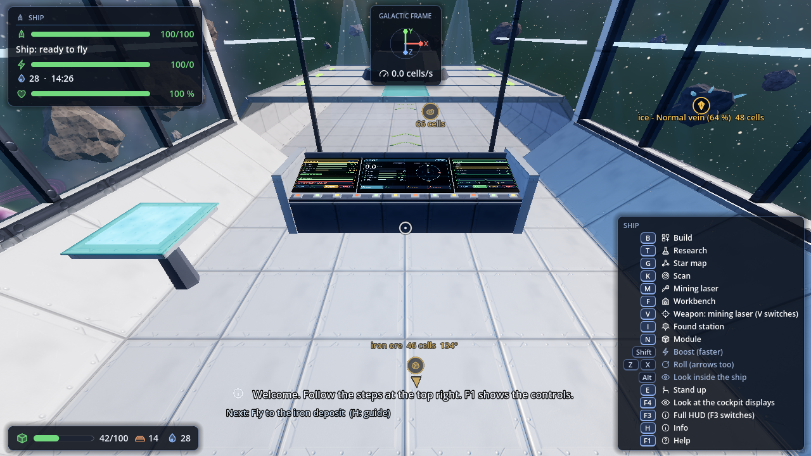

# Cockpit displays, HUD modes and smoother motion

Status: prototype, checked by unit tests and headless screenshots only. Nobody has used it by hand; the screenshots are the only look at it so far.

The pilot's console had three decorative screens. They are now real displays: the flight information that the outside HUD draws is also drawn on them, they react to the crosshair, and the outside HUD can be turned down so the cockpit carries it.

## The displays

Three screens, pilot's left to right. Each shows one of four pages; one page is always off, and picking a page that is on another screen swaps the two (`CockpitPages`, engine-free).

| Page | Shows |
|---|---|
| Flight | the speed (large), speed bar, boost chip, thrust, hull, power, hydrogen with the time it lasts, hold; the galactic frame (the HUD gizmo, bigger) with the velocity dot in the ship's own axes: centre = nose, rim = 90 degrees, hollow dot = drifting backwards |
| Nav | the system, up to six targets (the nearest enemy and the free port first, then the selected deposit, the gate toward the system chosen on the map, then the other known deposits by distance) with the distance and the degrees to turn; previous and next deposit, autopilot to the chosen deposit, assisted dock approach (`U`), scan (`K`) |
| Systems | hull, power, hydrogen, hold; the modules as a row of cells (damaged ones red); the threat banner; the weapon group button |
| Weapons | mining laser and guns with their state (ready, firing, mining, armed, not fitted), the weapon group button (`V`), the mining button (`M`) |

Every display also has the HUD-mode button in its header and a tab strip along the bottom. Colours and icons are the shared `UiTheme` tokens and the `Icons` set; nothing is external art. A faint grid, scanlines every third row, a slow bright band and a blinking lamp make a screen visibly live.

## How they are made

- `game/CockpitScreenView.cs`: a `Control` that draws one page in code (`_Draw`) from a plain `CockpitSnapshot`, and remembers the buttons it drew (`Buttons`, in texture pixels).
- `game/CockpitDisplays.cs`: one `SubViewport` per screen (720x400 centre, 496x400 sides) whose texture is the **unshaded, slightly over-bright** albedo of a quad parented to the cockpit module, over a dark bezel. The viewports render on demand (about 15 times a second, the focused one every frame), not every frame. `Raycast` takes the crosshair ray into a quad's own frame (inverse of its global transform), so the ship's attitude and the console's tilt and squeeze need no special care.
- **Attachment point.** `CockpitScreenLayout` is the only place that knows where the screens are: the deck origin, its tilt and the ship squeeze of the console model (`ModuleModels.Cockpit`), and a table of rectangles on the deck (position, size, texture size). When the console geometry changes, change those constants. The quads are rebuilt whenever the cockpit module node is rebuilt (`Attach` is called every frame with the current node, `StationView.ModuleNode`).
- `game/Play.Cockpit.cs`: the data (`BuildCockpitSnapshot`, 15 times a second: reads the same simulation getters the HUD reads), hover, clicks, focus and the HUD mode. Pressing a button sends the same commands as the key it stands for (`SetThrust` through the autopilot, `SetWeapons`, `Scan`, `DockAt`...); the simulation never sees the displays.
- The emissive material that was tried first washed out white in the lit cockpit; the unshaded one does not, and its values over 1 pass the environment's glow threshold, so lines and text bloom.

## Using them

- Put the crosshair on a screen (hold `Alt` while seated to look at the console without steering) and click: a button under it is pressed; a click on a screen without a button moves the view in on that screen. `F4` focuses the centre display.
- **Focus.** The head turns toward the screen and the field of view narrows so the screen fills about 70 percent of the view (down to 18 degrees); the mouse moves the view over the screen instead of steering (a clamped offset), left and right change screen, up and down change page, `F4`, `Esc` or the right button leave; standing up, opening a menu or the map also leaves it. The ship keeps flying with `WASD` along its own axes while a display is in focus. While you look at a display the outside cards and markers are hidden.
- Readability: seated at rest at 720p the centre screen is about 150 pixels wide, enough for the big numbers and the colours, not for the small text; in focus it fills more than half the width (about 750 pixels at 720p, 1100 at 1080p) and everything reads.
- The key panel has an `F4` row (look at the displays), an `F3` row naming the HUD mode, and its own context while a display is in focus.

## HUD modes (`F3`)

`HudMode` is Full (the overlay of old), Cockpit only or Minimal; `HudModes.Layers(mode, seated)` says which families of the overlay show (cards, markers, flight readout, key panel, toolbar, toasts). The choice is saved in `settings.cfg` (`hud_mode`). Sitting is where the displays take over; standing, a mode never hides what walking and building need. The crosshair, the alert and the notifications are always on. The rules are in `HudMode.cs` and tested.

## Smoother feel (client only)

None of this touches the simulation or the rules of ADR 0030: the attitude that `SyncAttitude` sends is the one the ship has, still throttled as before.

- **Mouse turn inertia** (`AngularInput`): the mouse motion is added up and handed to the attitude with a time constant of 45 ms, so a flick takes a few frames; nothing is ever lost (tested). Alt-look, standing, docking or the setting off apply whatever is pending at once.
- **Roll** eases in and out (`MotionSmoothing.Damp`, 9 per second) instead of switching.
- **Walking** accelerates and brakes (34 and 40 cells per second squared, about a tenth of a second) and has a faint head bob (about a hundredth of a cell) that grows with the speed.
- **Sitting down and standing up** glide the eye (`EyeBlend`, decaying offset) instead of cutting.
- **Field of view** eases (8 per second), widens 4 degrees while boosting and narrows for a focused display.
- The setting is *Smooth piloting* (Settings page, `smooth_look`, on by default). The screenshot runs snap everything (as the HUD fades do), so `--flight-shot`, `--walk-shot` and the others are unchanged.

## Tests

`CockpitTests` (engine-free): the page state machine (initial layout, swap, hidden page, cycling and a 500-step random walk keeping the invariant), HUD mode rules and cycling, the settings round trip and defaults for old files, the velocity indicator maths (centre, rim, behind, still, bounds over random velocities), display data fractions and formatting in both cultures, the nav list order, truncation and selection stepping, and the easing helpers (damping without overshoot and frame-rate independence, acceleration limits, no lost mouse turn, the eye blend). `KeyHintsTests` covers the new rows and the console context. Visual check: `--cockpit-shot` (see the [play-test guide](../playtest.md)).

## Not done

Boost has no button (the engines read the key each frame); the screens are not dimmed by low power; the mouse cannot click the screens while it is free (`Tab`); the target list cannot select a port or the gate (the gate is chosen on the star map); there is no sound beyond the UI click; head bob and the other easing are not checked by hand.
