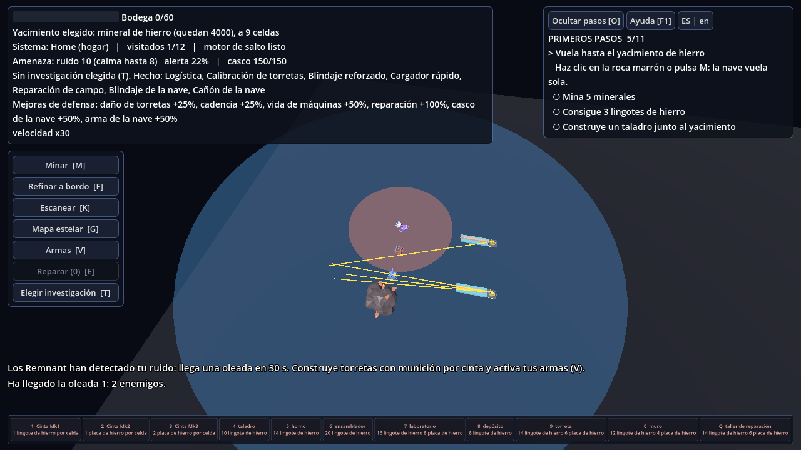

# Prototype P13: defence upgrades

Status: done, awaiting a human play-test (2026-11-20). Ship upgrades added the same day. Decision: [ADR 0013](../adr/0013-defence-upgrades-are-research-bonuses.md) (proposed). Builds on [walls and repairs](walls-and-repairs.md) and [repair bays](repair-bays.md).

## What it adds
| Area | Change |
| --- | --- |
| Content format | A research node may have `bonuses` (`turret_damage`, `turret_rate`, `machine_hp`, `repair_heal`, each with a `percent`); bonus-only nodes are valid; part of the content hash |
| Simulation | Bonuses add up over finished research; turret damage and interval, machine maximum hit points and repairer heal read them; machines standing keep their share of hit points when the maximum grows; repair, repairers and the invariant check use the effective maximum |
| Research | Four nodes, plates only: **turret calibration** (150 plates, +25 percent damage), **reinforced plating** (200, +50 percent machine hit points), **rapid loader** (250, 25 percent shorter interval, needs calibration), **field repair** (250, +100 percent repair, needs plating); calibration and plating need Logistics |
| Game | A status line with the active percentages, the research names in es and en, effective maximum hit points in the inspector, tooltips and the repair button |
| Balance simulator | `--upgrades=N`: after Logistics it keeps the lab on the next upgrade, and builds a second plate output so building and research both get plates |

```powershell
dotnet run --project tools/Starfoundry.Balance -- --delay=15 --observe=300 --minutes=400 --turrets=1 --walls=4 --bays=2 --upgrades=4
```

## Results
When the upgrades arrive (default seed, 15 s per action): Logistics 10:57, calibration 20:57, plating 34:17, rapid loader 50:57, field repair 67:37, about one upgrade every 10 to 17 minutes.

First machine lost, as the wave number (1 is the first wave), seeds 20261120, 1 and 2:

| Defence | No upgrades | 1 | 2 | 3 | 4 |
| --- | --- | --- | --- | --- | --- |
| One fed turret | 9, 12, 11 | 12, 12, 11 | 12, 12, 11 | 13, 14, 14 | 13, 14, 14 |
| One turret, four walls, two repair bays (2 and 4 upgrades only) | 17, 19, 19 | not run | 30, 21, 26 | not run | 27, 27, 26 |

Alone, the four upgrades are worth two to four waves to a single turret. On a full defence they are worth seven to ten, because plating makes every wall and bay tougher and field repair makes the bays heal twice as much.

## Ship upgrades
The same mechanism now reaches the ship: two more bonus kinds, `ship_hull` and `ship_damage`, and two nodes, **ship armour** (200 plates, needs reinforced plating, +50 percent hull, 100 to 150 points) and **ship cannon** (250 plates, needs calibration, +50 percent weapon damage). A hurt ship keeps its share of the hull when armour arrives, a rebuilt ship returns at the new maximum, and the status panel shows the hull as current over maximum.



In the scripted runs they are weak: first machine lost with one fed turret, seeds 20261120, 1 and 2: none 9, 12, 11; the turret and repair upgrades (four) 13, 14, 14; the ship path (calibration, plating, armour, cannon) 14, 12, 11; all six 16, 14, 14. The ship nodes also arrive late (armour at 81 minutes, cannon at 98) when they come after the four defence nodes. The scripted ship sits at the base with its weapon on, which is a small part of the defence; a flying, fighting player should gain more, which only a human play-test can say.

## Findings along the way
- The first run with upgrades could not pay for building: one plate line fed both the lab and the plate depot, so the bot builds a second plate output.
- A bonus to maximum hit points needs a rule for the machines already standing; keeping their share (a full machine stays full) avoids both a free heal and a sudden loss.
- Reading every number through the network (`MaxHp`, `TurretDamage`...) rather than the content found a few places that used the base value (the repair formula, the inspector and the damaged-machine tint).

## Targets pinned by tests
One fed turret: the four upgrades hold at least two waves longer than none (seeds 20261120 and 1). Four walls and two bays: at least six waves longer (default seed). The upgrades arrive in order, the first within 5 to 20 minutes of Logistics and all four inside two hours. Unit tests cover content loading and validation, the formulas, bonuses adding up, standing machines keeping their share, repairs using the higher maximum, bonuses surviving a rolled-back batch, upgraded turrets clearing a wave sooner and determinism. 327 tests.

## Known limitations
- Nobody has played it by hand: the research choice (key `T`), the new status line and the names were seen in code and tests, not in a played game; the status line was seen on screen only with the screenshot flag `--grant-upgrades`, which finishes every bonus research before the demo; no demo finishes an upgrade by playing.
- Upgrades arrive late for the first waves (the first one 10 minutes after Logistics, the last more than an hour in), so the early game is unchanged.
- No carbon in the costs. Repeatable upgrades came later, see [repeatable upgrades](repeatable-upgrades.md).
