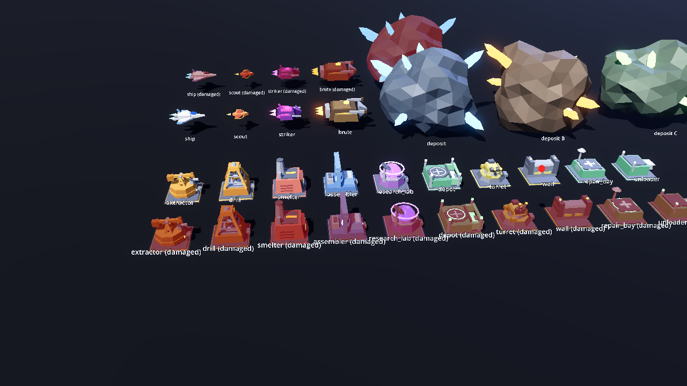

# Prototype P15: leaving the home ore behind

Status: done, awaiting a human play-test (2026-11-20). Follows from [fair outputs and the home ore](fair-outputs-and-ore.md), which found that a growing factory empties the 4,000 ore of the home deposit in about two hours.

## The question
How soon can a player expand to another deposit, what does it take, and what is left at home when they do?

## What it adds
| Area | Change |
| --- | --- |
| Guided steps | A twelfth step, **Jump to another system**, ticked off by the first visit to a system other than home. Its hint says the home deposit runs out in a couple of hours and names the way: research carbon drilling and the jump drive (`T`), scan (`K`), jump (`G`, `J`) to a system with iron. es and en |
| Balance simulator | `--expand`: after Logistics the lab researches carbon drilling and the jump drive; a second lab beside the carbon deposit gets carbon from a drill by belt; the ship hand-mines the fuel for a round trip (10 carbon), jumps to the nearest neighbouring system whose archetype makes iron, scans, flies to the closest deposit, builds an ingot line and a plate line there (each paid from the hold, one placement at a time) and jumps home. Milestones and the home iron left at each are in the report |
| Game | A warning when an ore is running low in the system the ship is in: at 25 percent or less of the revealed deposits of that ore, a line in the status panel and a toast the first time ("Little iron ore left in this system (20%): scan and jump to another system"), es and en. The share is computed by `OreRunway` in the engine-free interface library and tested |
| Balance simulator | `--take-down-carbon`: once the jump drive is researched the bot removes the carbon drill, belt and second lab and gets the ingots back |

```powershell
dotnet run --project tools/Starfoundry.Balance -- --delay=15 --observe=40 --minutes=150 --turrets=1 --walls=4 --bays=2 --expand --extra-plates
```

## Results
Default seed, 15 s per action, one fed turret, four walls, two repair bays and a dedicated plate line:

| Milestone | Time | Home iron left |
| --- | --- | --- |
| Logistics researched | 10:57 | |
| Carbon drilling researched | 21:11 | |
| Carbon line built | 21:13 | 2,825 |
| Jump drive researched | 37:05 | 2,273 |
| Jump out, arrive, scan | 37:13, 37:16, 37:17 | 2,264 |
| Remote ingot and plate lines built | 38:57 | 2,164 |
| Back at the base | 39:02 | 2,156 |

The same run on other seeds: jump drive at 36:20 to 36:55, remote lines at 38:51 to 43:02, home again at 38:56 to 43:07. The first remote deposit had 2,499 ore.

- **The jump is plate-limited, not carbon-limited.** The two researches cost 135 plates (carbon drilling) and 225 plates with 75 carbon (jump drive); the carbon arrives in a couple of minutes, the plates take a quarter of an hour each. The round trip costs 10 carbon, hand-mined.
- **About 40 minutes in, a player can leave with more than half of the home ore still there** (54 percent), and the building at the new deposit takes under two minutes.
- **The remote lines delivered almost nothing in the first hour** (28 items): the hold already holds the most a depot will deliver of each item, so they only replace what is spent. They matter once the home ore is gone.

## Findings
- **Taking the carbon line down fixes that loss.** With `--take-down-carbon` the first machine fell during wave 18 instead of 12 (17 and 19 without any expansion), so the second lab and the drill were the cause.
- **The expansion costs defence upgrades time.** Carbon drilling and the jump drive are 360 plates of research before any upgrade. With four upgrades queued behind them the first loss came at wave 19 and 17 (seeds 20261120 and 1), against 25 and 24 without the expansion: the upgrades arrive about 25 minutes later, and the remote lines delivered only 64 and 47 items before the loss, so they had not yet replaced anything. A player should expand when the home ore starts to run low, not as early as the scripted player does.
- **Infrastructure outside the defence is the first thing lost.** In the same run the first machine fell during wave 12, against 17 and 19 without the expansion: the second lab and the carbon drill sit at the carbon deposit, outside the turrets' reach, and the loudest machine is what enemies attack. A player who expands has to defend the new buildings or accept losing them.
- **Staged building is needed.** The ingots of the whole carbon line (29) are more than the hold keeps from depots (24 of one item), so it cannot be placed as one batch; each piece has to be paid separately.
- The ship being away costs nothing in the scripted run (two minutes, the round trip is a few seconds); a long stay would leave the home base without repairs or rebuilding.

## Targets pinned by tests
For two seeds (20261120 and 1): the jump drive is researched 30 to 45 minutes in; the remote lines are built within one to five minutes of arriving; the ship is home again 35 to 50 minutes in, after the lines; at least 40 percent of the home ore is left when the remote lines are built; the guided step is ticked off. 337 tests.

## Known limitations
- Nobody has played it by hand. The scripted player knows where the carbon deposit and a neighbour with iron are; a person has to find them (scan, the star map).
- Only the first expansion is measured. Whether the remote lines keep the defence alive after the home ore ends, and what a second or third expansion costs, are not.
- The remote lines are undefended; waves for a system with machines in it come from its own signature, which the scripted run does not wait to see.
- Only plates for the first two researches limit the time to jump; with a faster plate line it would be earlier.

## The cargo port


The expansion exposed a gap: the remote lines fill the hold, but nothing took items out of the hold onto belts, so the home ammo lines went dry once the home ore ended whatever the player had mined elsewhere. The **cargo port** (`core:unloader`, [ADR 0015](../adr/0015-cargo-ports-unload-the-hold-onto-belts.md)) is the missing piece: it moves one ingot every half second from the owner's hold to a belt, keeping a reserve of 10 in the hold. 80 hit points, 12 ingots and 4 plates, unlocked by the jump drive. Build key `B` (the build bar has twelve items), model, status text and tooltip in es and en.

Measured with three fed turrets, four walls, two repair bays and four upgrades; the bot expands when the home iron is at or below 40 percent, takes the carbon line down and, with `--port`, replaces the drill and smelter of every ammo line with a port:

| Seed | Waves seen without | Waves seen with ports | First machine lost without | with | Items from the remote lines |
| --- | --- | --- | --- | --- | --- |
| 20261120 | 30 | 34 | 30 | 30 | 358 |
| 1 | 30 | 35 | 30 | 31 | 400 |

The home iron is gone at about 100 minutes in both runs. With the ports the turrets keep their ammo and the base survives four or five more waves, but the first loss stays at wave 30 or 31: the supply stops being the limit and the strength of the waves is. The remote lines delivered a few hundred items and the remote deposits were far from empty (1,957 and 602 ore left at the end).

Pinned by a test (default seed): the ammo lines are switched, the remote lines deliver at least 200 items, and the base sees at least three more waves than without. Unit tests cover the role and its numbers, the unlock, moving ingots down to the reserve, never taking what a full belt cannot carry, taking only from its owner's hold, carrying only its item and needing a belt, refusing an input belt, feeding an assembler from the hold deterministically, and content validation. 349 tests.

Limitations: only ingots are carried; the port was seen in the gallery and in the scripted runs, not placed by hand; the build key `B`, the model in the world and the status text have not been used in a played game.
