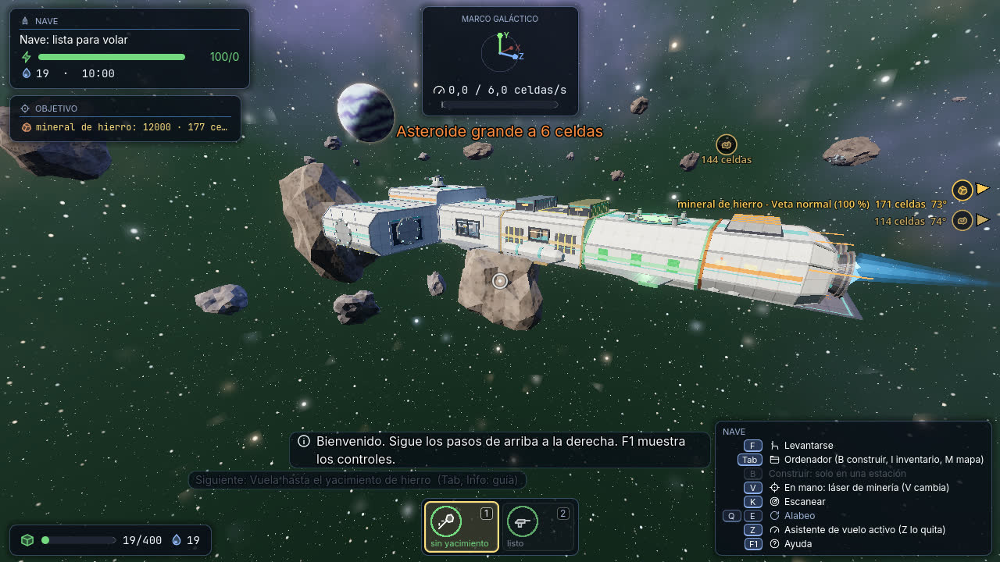
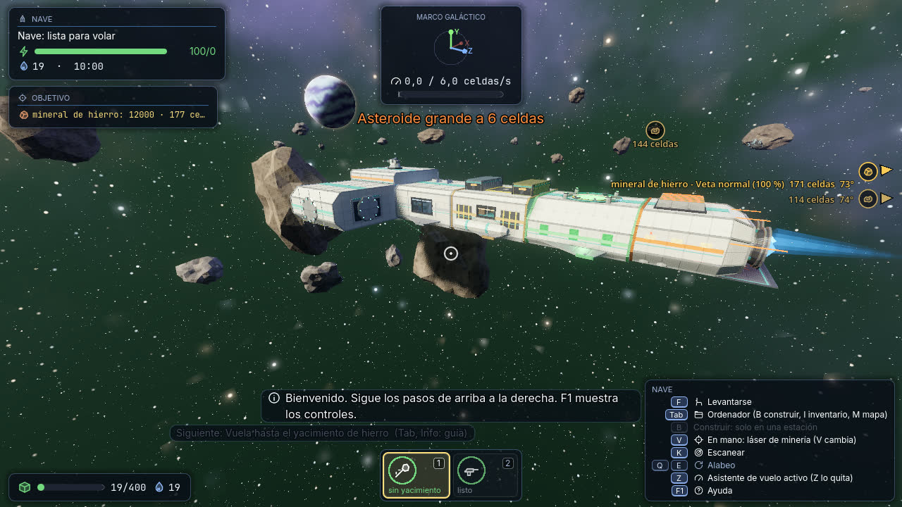
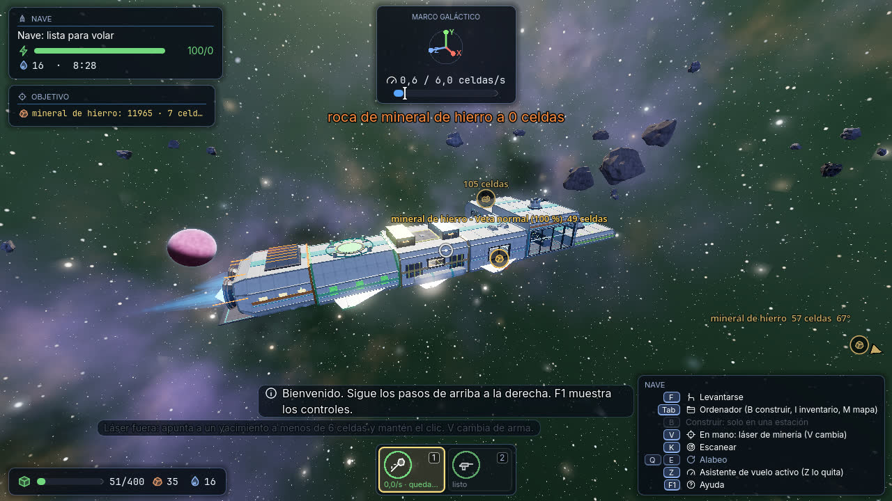
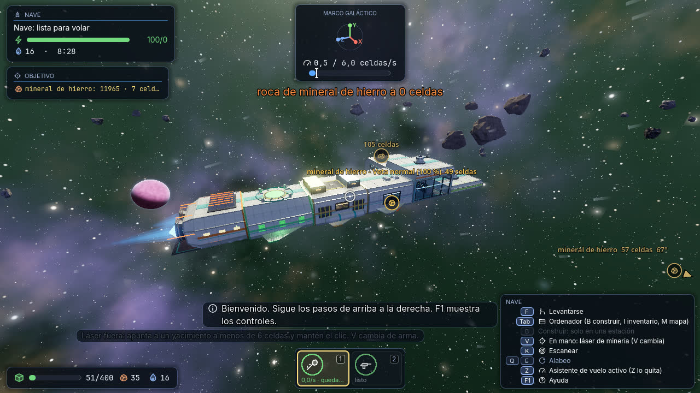
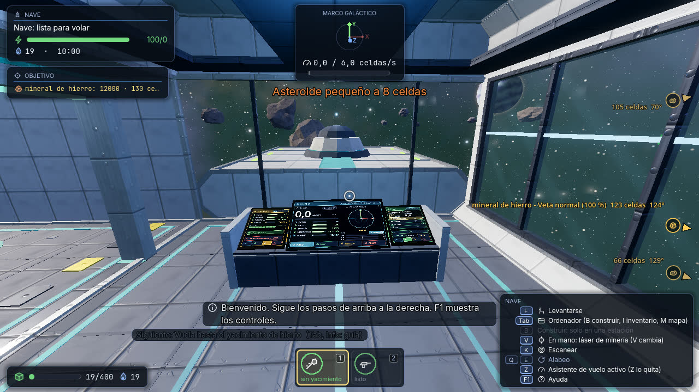
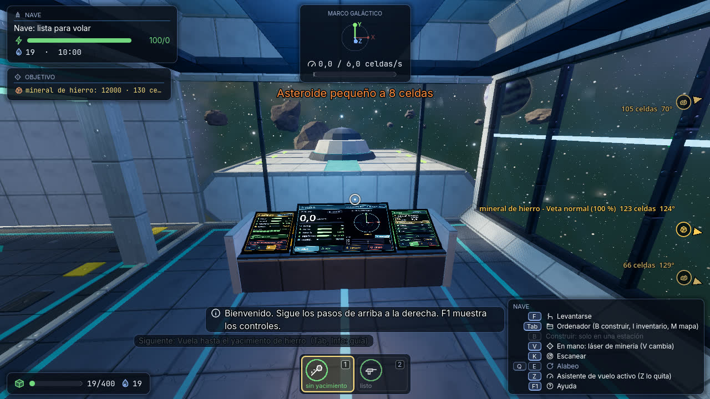
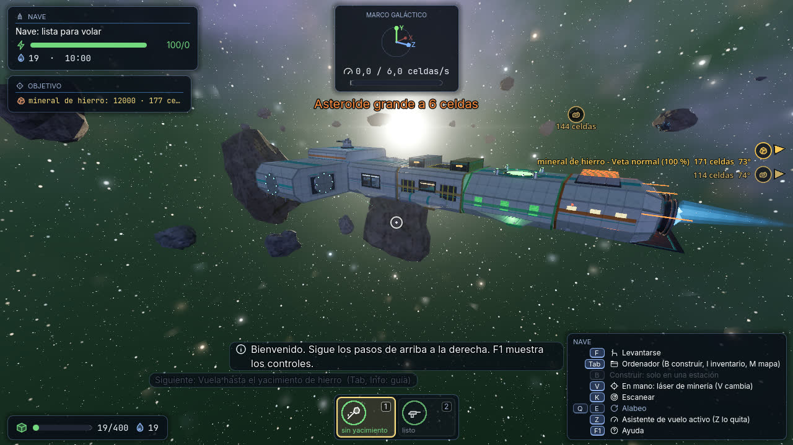

# Lighting pass (2026-11-27)

Status: done, client only (branch `feature/lighting-pass`). It implements the top-ranked, cost-safe items of the [lighting study](lighting-study.md) (ranks 1 to 8) and adds a graphics quality setting. There is no simulation change, no log version, no content change (the star light table lives in the client, so the content hash is untouched) and no new asset. Numbers marked *measured* come from the runs below; every colour and energy is a *proposal* tuned by eye on 1280 by 720 shots, not seen by the owner on other screens.

## What changed

| Area | Before | After | Where |
| --- | --- | --- | --- |
| Key light | one hash-coloured sun, energy 1.1, no shadows | colour and energy from the system's **star type** (table below), blended 15 percent with the seed hue so two systems of one type differ; casts shadows on Medium and High | `Ambience.Retint`, `StarLight` |
| Star table | none (a blue giant could have a yellow sun) | yellow dwarf warm white 1.25, red dwarf deep orange 1.0, orange star 1.15, blue giant blue-white 1.6, binary a warm key 0.85 plus a cool second sun 0.7 (also a second disc in the sky, no shadow), pulsar cold white 1.35 flickering 8 percent at about 1.3 Hz | `GraphicsQuality.cs` |
| Fill | a 0.3 blue fill light | a **rim light**: energy 0.2, full specular, behind the shadow side, in the nebula tint | `Ambience.Retint` |
| Ambient | sky ambient 1.35 | 0.6 on Medium and High (0.9 on Low, close to the old look) | `QualityProfile` |
| Shadows | none in play | Medium: one cascade, 2048 atlas, 170 units; High: two cascades, 4096, 300 units; bias 0.03, normal bias 1.2, blur 1.4, cascade blend and fade; strips, sparks, puffs, dust and streaks never cast | `Ambience.ApplyQuality`, `NoShadowFromDecoration` |
| Anti-aliasing | none | MSAA 2x (Medium), 4x (High) on the main view | `Ambience.ApplyQuality` |
| Occlusion | none | SSAO on High, radius 0.6 | `Ambience.ApplyQuality` |
| Bloom and tone | ACES 1.05 / 6.0, glow threshold 1.0, intensity 0.6 | ACES 1.0 / 6.0 (AgX was tried and dropped, see below), threshold 0.9, intensity 0.75, bloom 0.1, contrast 1.08 | `Ambience.Build` |
| Fog | exponential 0.0012 | same, plus sun scattering 0.12 (Medium) or 0.2 (High) so the haze brightens towards the star | `Ambience.ApplyQuality` |
| Sun glare | the sky disc only | one additive, depth-tested quad on the sun's direction (core, halo, two streaks), faded by how directly the view faces the sun; rocks, the hull and the cockpit frame cover it | `Ambience.UpdateSun` |
| Interior | one lamp per module | plus, on Medium and High, a cool screen lamp and a warm low seat lamp in the cockpit and a dim floor "bounce" lamp in every closed room (no shadows, fade 24 + 14 units, group `interior_extra`, switched live by the quality setting) | `ModuleDetail.InteriorExtraLamps` |

The interior reads darker mainly because of the shadowed sun and the lower ambient: the hull now blocks the key light, so a room is lit by its lamps and by the sun only where it comes through a window.

## The graphics quality setting
Settings has a **Graphics quality** button (es: "Calidad gráfica": Baja, Media, Alta; en: Low, Medium, High) that cycles the level and applies at once, also on the main-menu background. It is saved as `graphics_quality` in `settings.cfg` (an older file without the key gets Medium). `--quality=low|medium|high` forces a level for one run without touching the file; `--sun=azimuth,elevation` (degrees) fixes the sun direction so shots are comparable.

| Level | Shadows | MSAA | SSAO | Ambient | Extra interior lamps | Sun glare |
| --- | --- | --- | --- | --- | --- | --- |
| Low | off | off | off | 0.9 | off | off |
| Medium (default) | 1 cascade, 2048, 170 units | 2x | off | 0.6 | on | on |
| High | 2 cascades, 4096, 300 units | 4x | on | 0.6 | on | on |

The numbers of a level are plain data (`GraphicsQualities.ProfileOf`) with unit tests. Rocks cast and receive shadows like everything else on Medium and High, limited by the shadow distance (the shadow pass only draws what is inside it); on Low nothing casts.

**Compatibility renderer.** The project is Forward+ only (`config/features`), so there is no Compatibility build to test. Because that renderer has no SSAO and only a small per-object light limit, the code forces the Low profile when `RenderingServer.GetCurrentRenderingMethod()` reports `gl_compatibility`. *TBD*: this guard was not run, since no Compatibility build exists.

## Measurements
Setup as in the study: play copy of the checkout (`tools/agent/new-play-copy.ps1`), windowed at 100,100, 1280 by 720, primary monitor, `--stress=200 --stress-close` (200 machines in view, 300 frames after 60 warm-up frames, vertical sync off), RTX 4080 SUPER, Godot 4.7.2 Mono, three runs per setting. The frame times are quantised near 2.78 ms on this machine, so differences below about 0.2 ms are noise.

| Build | Runs (avg ms) | Mean avg ms | fps |
| --- | --- | --- | --- |
| Before (origin/main) | 2.26, 2.27, 2.40 | 2.31 | 433 |
| Low | 2.32, 2.09, 2.20 | 2.20 | 455 |
| Medium (default) | 2.63, 2.62, 2.92 | 2.72 | 368 |
| High | 2.65, 2.91, 2.91 | 2.82 | 355 |

Medium costs about +0.4 ms (shadows, MSAA 2x, glare and the extra lamps) and High about +0.5 ms in this scene of 200 small casters, in line with the study's +0.5 ms for a shadowed sun. Low is at or under the old cost. The `process_ms` column of the tool is not trustworthy (it reads hundreds of milliseconds) and is ignored, as in the study.

## Before and after
All six pictures use `--sun=200,35` in both builds so the light comes from the same side (the before copy was patched with the same flag; nothing else differs).

| | Before | After (Medium) |
| --- | --- | --- |
| Ship and rocks from outside |  |  |
| Ship from the front, sky and planet |  |  |
| Cockpit seat |  |  |

Sun glare (the sun behind the ship, `--sun=325,0`): 

What the pictures show: the hull now has a lit side, a dark terminator and the shadows of its own roof boxes and of nearby rocks; the rocks have a dark side; the cockpit floor falls off into shadow instead of being evenly blue; the sun gets a bloom and streaks behind the hull.

## Decisions made while doing it (all *proposal*, easy to change)
- **ACES stays.** AgX (`ToneMapper.Agx`) was tried on the same shots: it washed the hull to near white and greyed the violet nebula. ACES with white 6.0 keeps both.
- **MSAA instead of TAA or FXAA.** TAA smears the motion streaks and fast-moving debris; FXAA softens the thin hull lines. MSAA 2x is the default, 4x on High.
- **The star table is client only** (`StarLight.For(starId)`), so it needs no content-hash change. A mod's unknown star falls back to the yellow dwarf. Moving it into `world.star_types` is the owner's choice (study decision 2).
- **Shadow distance in client units (cells).** A module is 8 units long and a ship about ten modules, so 170 covers the ship and the rocks around it from the seat; 300 on High.

## Not done, and not verified
- **No automatic shadow cut when many machines are in view** (the study's idea). Frame cost grows with the number of casters; at the 5,000-machine scale of [render performance](render-performance.md) the owner should drop to Low by hand. Not measured above 200 machines.
- **Corridor spot lights and a docking-bay spot light** (study 3.3) were not added: the lamp budget stays one lamp per module plus the optional extras. Bays and corridors rely on emissive trims.
- **Volumetric fog, SDFGI, planet atmospheres and rock eclipses by ray test** (study ranks 9 and 10, 3.4) are not in this pass.
- **Only one machine, one monitor, 1280 by 720.** Not run on a weaker GPU, integrated graphics, 1080p or 4K; MSAA 4x, SSAO and the shadow atlas cost more there. The Compatibility guard has never run.
- **The editors and previews** (blueprint editor, gallery, build preview, designer) keep their own simple environments and do not use the quality setting.
- **Hand look:** shadow flicker and cascade popping while moving are not visible in stills; nobody has flown it. The light range of the interior lamps was tuned by eye on one cockpit view; stations, the corridor of long ships and the walkthrough were not looked at.
- The pulsar flicker (8 percent, about 1.3 Hz) is gentle but there is no reduced-motion switch yet (the route's accessibility item 4.2).
