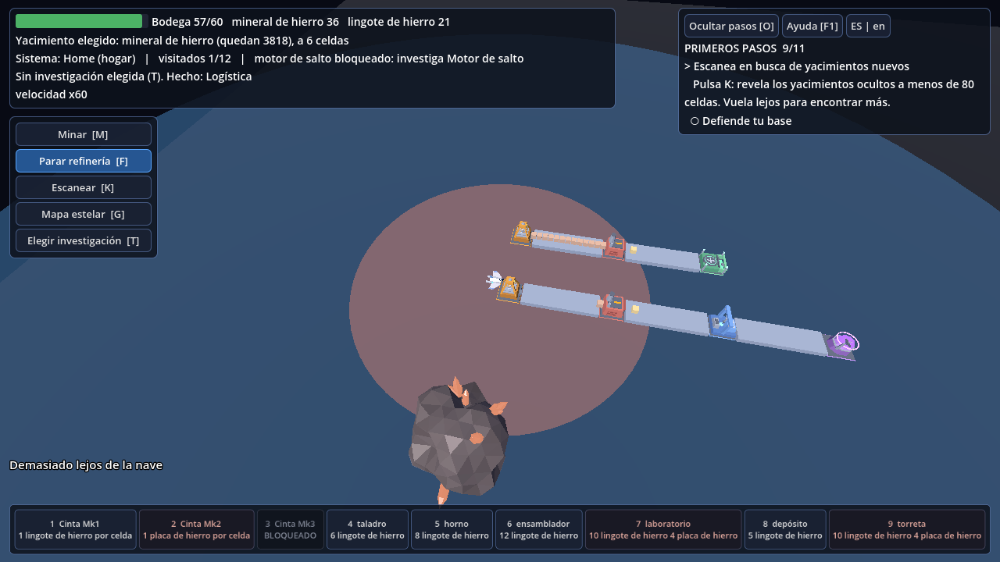
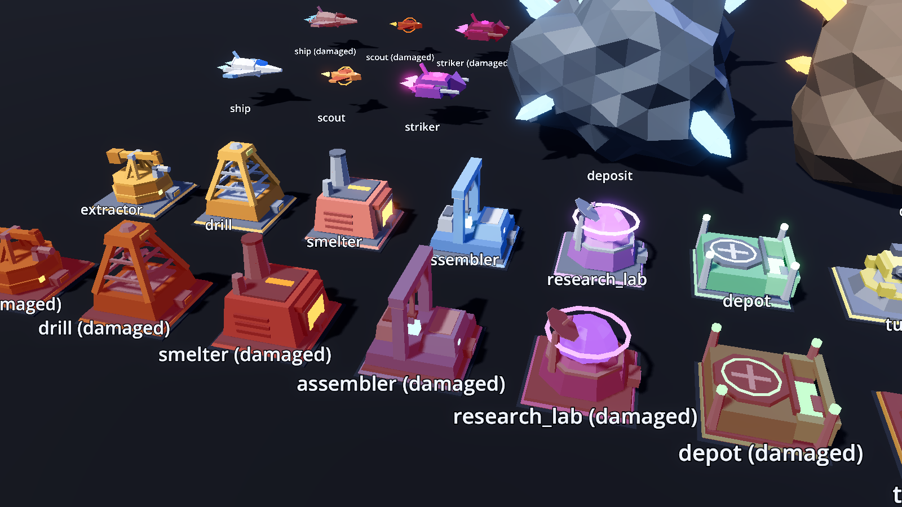
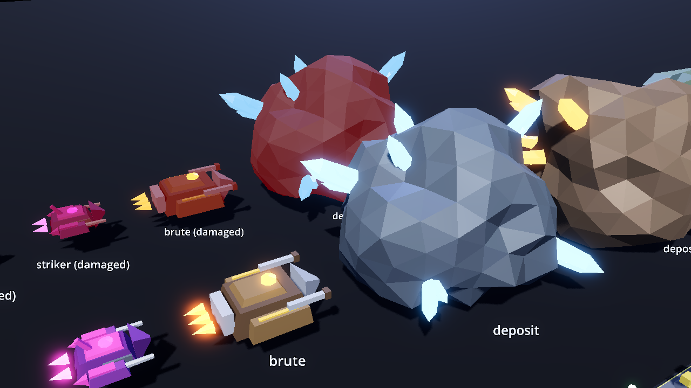

# Prototype P8: loop polish and intuitive controls

Status: done, awaiting a human play-test (2026-11-20). Builds on the [playable loop](playable-loop.md), [world and ship](world-and-ship.md) and [threat and combat](threat-and-combat.md).

## Goal
A first-time player should be able to open the game and know what to do without reading a spec: every action is a visible button or a mouse gesture, every refusal says why, and the first hour is guided.

## What changed
| Area | Change |
| --- | --- |
| Mouse | Left click on a machine inspects it, on a deposit selects it, on empty space flies the ship there (autopilot). With a build tool selected it places; drag lays belt lines. Right click demolishes (only if the mouse did not drag). Wheel zooms; middle or right drag orbits the camera; `Home` recentres |
| Keyboard | `WASD` fly relative to the camera (the yaw snaps to 90 degrees so the intents stay on world axes), `Space`/`C` up and down, `M` mine (flies to the deposit first), `F` refinery, `K` scan, `V` weapons, `T` research, `G` map, `Tab` recipe, `R` rotate, `Esc` leaves the build tool, `F1` help, `L` language |
| Buttons | Mine, refinery, scan, star map, research and jump are clickable, show their key, and have tooltips |
| Build bar | Cost per item, locked items greyed, items you cannot afford in red; shrinks to fit narrow windows |
| Ghost | The build preview turns red and the reason appears in plain language (overlap, out of range, locked, not enough items) |
| Inspector | Click a machine: status line (working, waiting for inputs, output blocked, no recipe, out of ammo...), recipe, refund, and a demolish button |
| Guided steps | Twelve steps (the last, to jump to another system, was added with the [expansion](expansion.md)) from "fly to the iron deposit" to "defend your base", ticked off by watching the simulation; hideable with `O` |
| Language | Spanish and English for every string (`L` toggles; defaults to the system locale). Game data names come from the same table |
| Hold | A red bar and a toast warn when the hold is full and mining or depots stop |

## Design notes
- The interface text and the guided steps live in a pure library, `Starfoundry.Ui` (`Loc`, `ObjectiveTracker`), so they are tested without the engine. Godot only renders them.
- Commands stay the only way to change the world: every click ends in a `Command` through `SimWorld`, so nothing in the new controls can break determinism or replay.
- Objective completion is sticky: tearing a machine down later does not un-tick the step.

## Tests
- Every localisation key has Spanish and English text with matching `{n}` placeholders.
- Every literal key used by `game/*.cs` exists in the table (the test scans the sources), and every machine role, item, machine, recipe and research has a display name.
- Objective keys exist, the tracker starts at the first step and is stable between updates.
- Total: 267 tests (258 before this prototype).

## Measurements
Run with the bots on this machine (Godot 4.7.2, 1280x720, 2026-11-20). No numbers were changed in this prototype; these are the baselines for a later balance pass.

| Bot | Result |
| --- | --- |
| `--demo --speed=60` | Logistics researched after 2.9 simulated minutes at the time of this prototype (9.6 after the [balance pass](balance-pass.md)); invariants valid |
| `--explore-demo --speed=30` | 7 of 12 systems visited in 30 simulated seconds, 7 scans, 6 jumps, 27 of 47 deposits revealed |
| `--threat-demo --speed=30` | 1 wave, 2 enemies spawned and killed, no machine or ship lost, 6 ammo fired |

The results match those recorded before the interface rewrite, so the new layer did not change simulation behaviour.

## Known limitations
- Nobody has played this by hand yet: the controls were exercised through the bots and screenshots. Mouse feel (camera orbit speed, autopilot arrival, drag thresholds) needs a human pass.
- The first balance pass is done ([balance pass](balance-pass.md)); it rests on a scripted player and still needs a human play-test.
- Only 1280x720 was checked by screenshot; very small or very wide windows are untested.

## 3D models

Every machine, the ship, both enemy types and the deposits now have a procedural low-poly model (`game/Models.cs`): flat-shaded meshes with vertex colours, generated from code, no art pipeline needed. Machines are one grid cell, the ship, enemies and deposits are free-flying with the nose along +X.

- `Models.Animate` spins drill augers, rocks the extractor beam, slides the assembler carriage, turns the lab ring and dish, and pulses the emissive parts; idle machines freeze and dim, so a stalled line is visible at a glance.
- `Models.SetDamage` darkens a machine towards red as it loses hit points.
- `Models.Aim` points a turret head and barrel at the nearest enemy.
- The ship turns to its heading; enemies face the ship.
- `game/Gallery.tscn` shows every model, clean and damaged (`-- --focus=machines|units|ships --shot=out.png`), and `--export-models=<dir>` writes them as `.glb` (committed under `game/assets/models`, about 0.8 MB, not loaded by the game: they are for inspection and future use).
- Triangle counts are 200 to 450 per model (the deposit about 970).

Limitations: machines, enemies and the ship are individual nodes, not MultiMesh instances, so a very large factory will cost more than the old boxes (measured since: see [render performance](render-performance.md)); the build ghost is still a box; damaged colours skew pink on blue and yellow parts; the animations were checked in single frames, not as motion.

### The brute

The heavy enemy of the [wave ramp](wave-ramp.md) has its own model (`Models.Enemy(2)`): a wide bronze slab with a steel ram prow, armoured flanks with amber stripes, two shoulder guns, an amber core and three engines. 216 triangles, exported as `enemy_brute.glb`. It animates like the other enemies (engines and core pulse) and takes damage tint. Seen in the gallery only: the game builds with it and the demos still pass, but no demo reaches the wave where it first appears, so it has not been seen in a fight.
