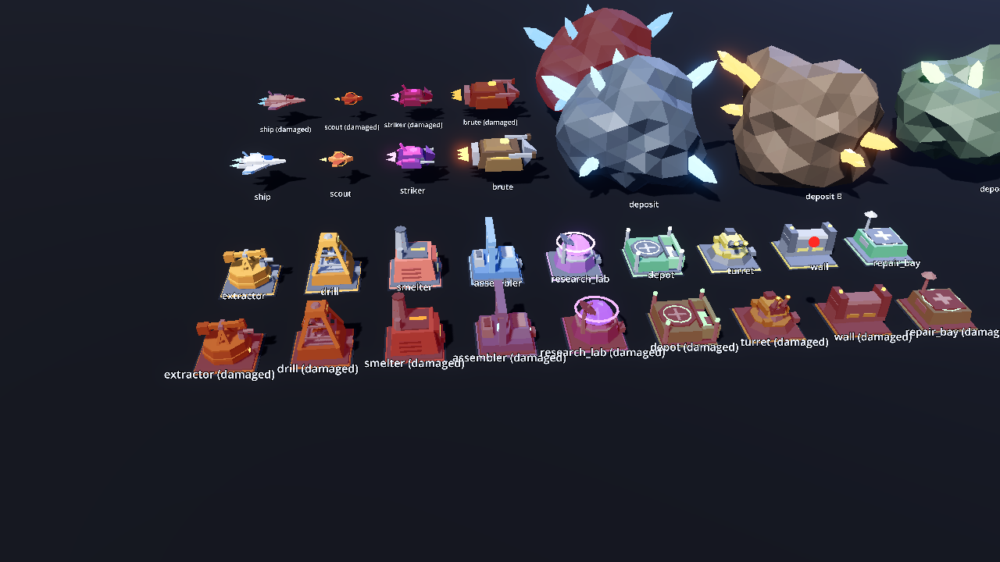

# Prototype P12: automatic repair

Status: done, awaiting a human play-test (2026-11-20). Decision: [ADR 0012](../adr/0012-repair-bays-heal-slowly-from-a-belt-fed-item.md) (proposed). Builds on [walls and repairs](walls-and-repairs.md).



## What it adds
| Area | Change |
| --- | --- |
| Content | Machine role `repairer` with a `repairer` block (range, heal, interval, item, item cap) and `core:repair_bay`: 120 hit points, 14 ingots and 6 plates, range 14 cells, 20 hit points per ingot every 30 ticks, buffer of 20 ingots |
| Simulation | Repairers take their item from a belt, heal the most damaged machine in range (lowest share of hit points first) and use one item; `AutoRepaired` counter; validation of the buffer and cooldown; the content hash covers the new data |
| Game | Repair bay in the build bar (key `Q`, the bar has eleven items), a model with a rotating beacon, status text (ready with ingots, or out of ingots) and tooltip in es and en |
| Balance simulator | `--bays=N` (up to two, each fed by a second output of a smelter) |

```powershell
dotnet run --project tools/Starfoundry.Balance -- --delay=15 --observe=100 --minutes=130 --turrets=1 --walls=4 --bays=2 --repairs=never
```

## Results
Walls lost in the first 100 minutes after the guided steps (one fed turret, four walls rebuilt when lost, no manual repair, 15 s per action):

| Seed | No bays | One bay | Two bays |
| --- | --- | --- | --- |
| 20261120 | 10 | 8 | 5 |
| 1 | 13 | not run | 7 |
| 2 | 12 | not run | 8 |

No machine was lost in any of these runs. The wave at which the first machine is lost did not move much with bays (default seed 15 without, 17 with two; seed 1 19 and 19; seed 2 16 and 19), while manual repair during the fights moved it to 21 to 28. A bay is upkeep, manual repair is the emergency tool.

## Findings along the way
- A bay heals about 20 hit points a second at most. A late wave does hundreds of damage a second, so a bay never saves a wall that is being shot, but between waves it brings a wall from near death to full in under a minute.
- The first measurement (waves held) showed almost no effect and looked like a failure; wall losses are the right measure, since damage that is never repaired shows up as walls that must be rebuilt.
- The bay needs its own ingot feed: it hangs off a second output of a smelter that also feeds a depot, so the two share the ingots.

## Targets pinned by tests
Two bays cut the walls lost over the first stretch of waves by a quarter or more with no manual repair, and still lose some (seeds 20261120 and 1). Unit tests cover the role (no output belts, quiet, slow heal), a fed bay healing a hurt lab to full while the enemies are drawn away, one ingot per heal, a bay without ingots or with the target out of range doing nothing, no healing when threats are off, a deterministic checksum, and content validation (missing data, wrong role, unknown item, zero heal, a recipe on a repairer). 312 tests.

## Known limitations
- Nobody has played it by hand: the new build key, the model in the world and the status text were only seen in the gallery and the bot-driven demos.
- Each bay heals one machine at a time; with several damaged machines the worst goes first and the rest wait.
- The bay shares ingots with the depot on the same smelter; a dedicated line would heal more but costs more.
- No repair of the ship hull, no drones, no bay variants.
