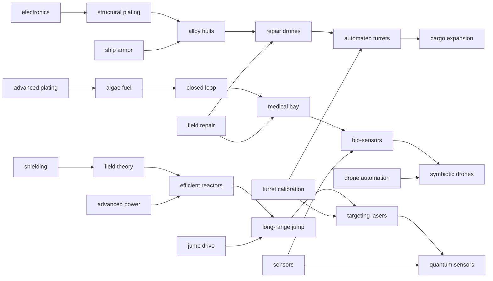

# Prototype: science fields and the extended research tree

Status: built (2026-11-22), simulation, content, Ui logic and the scripted player. Decision: [ADR 0026](../adr/0026-science-fields-and-research-expansion.md). Code: `content/core.json`, `ResearchView`, `StructureBot.Science.cs`. Tests: `ScienceFieldsTests`, `StructureEconomyTests`, `StructureBotTests`.

## The question
Can research items of three fields (engineering, biology, physics) be made by dedicated machines, travel by belt to the one building that researches, and unlock a second tier of fifteen nodes with real effects, without touching the default campaign path?

## Items, machines and recipes
| Item | Made by | Recipe | Time | Power |
| --- | --- | --- | --- | --- |
| Engineering science | engineering bench | 2 iron plate + 1 circuit | 6 s | 15 |
| Physics science | physics lab | 1 silicon + 1 nickel plate | 8 s | 18 |
| Biomass | greenhouse | 2 ice + 1 carbon | 10 s | 12 |
| Biology science | greenhouse (second one) | 1 biomass + 1 iron plate | 6 s | 12 |
| Hydrogen (2) | hydrogen cracker | 1 biomass (unlocked by closed loop) | 6 s | 12 |

A greenhouse has one recipe at a time, so biology needs two of them. The three machines are crafters (workshop and core modules), cost ingots and plates only and need no research. The research lab takes the science and the plates by belt like any other cost item.

## The tree
The 22 existing nodes are the Basic field (24 since the two mining laser nodes of [ADR 0027](../adr/0027-mining-laser-rules.md), which are not part of the science tier). Costs: science of the field plus iron plates.

| Field | Node | Science | Plates | Requires | Effect |
| --- | --- | --- | --- | --- | --- |
| Engineering | structural plating | 10 | 100 | electronics | module hit points +25 % |
| Engineering | alloy hulls | 15 | 120 | structural plating, ship armor | ship hull +30 % |
| Engineering | repair drones | 20 | 150 | alloy hulls, field repair | repair per use +50 % |
| Engineering | automated turrets | 25 | 150 | repair drones, turret calibration | turret fire interval -15 % |
| Engineering | cargo expansion | 30 | 200 | automated turrets | hold capacity +50 % |
| Biology | algae fuel | 10 | 100 | advanced plating | reactor fuel lasts +25 % |
| Biology | closed loop | 15 | 120 | algae fuel | unlocks biomass -> hydrogen at the cracker |
| Biology | medical bay | 20 | 150 | closed loop, field repair | repair +25 %, ship hull +20 % |
| Biology | bio-sensors | 25 | 150 | medical bay, sensors | sensor range +50 % |
| Biology | symbiotic drones | 30 | 200 | bio-sensors, drone automation | drone mining speed +30 % |
| Physics | field theory | 10 | 100 | shielding | shield absorption +10 points |
| Physics | efficient reactors | 15 | 120 | field theory, advanced power | reactor output +15 % |
| Physics | long-range jump | 20 | 150 | efficient reactors, jump drive | jump costs 1 carbon less |
| Physics | targeting lasers | 25 | 150 | long-range jump, turret calibration | turret damage +20 % |
| Physics | quantum sensors | 30 | 200 | targeting lasers, sensors | sensor range +50 % more |

Each field costs 100 science in all (and 720 plates). Sensor range of the two sensor nodes stacks (+100 %). Quantum sensors do not extend the wave forecast (the forecast has no range); that is left out.



## Bonus kinds added
| Kind | Where it is read |
| --- | --- |
| `module_hp` | `ModuleMaxHp` (modules at full health follow the new maximum; damaged ones keep their hit points) |
| `hold_capacity` | `HoldCapacityOf` (structure worlds) |
| `fuel_burn` | `BurnInterval` (reactors burn each unit longer) |
| `sensor_range` | `SensorRangeCells` (deposit reveal) |
| `drone_rate` | `DroneInterval` (shorter interval) |
| `shield_absorb` | `ShieldPercentFor` (points on the base and on the cap) |
| `power_output` | `StepPower` (before the world rule percent) |
| `jump_discount` | `JumpCost()` (items off every stack, never below 1) |
| `mining_rate` | `MineTicksFor` (ticks per item of the ship's mining laser; two Basic nodes, [ADR 0027](../adr/0027-mining-laser-rules.md)) |
| `engine_speed` | `EnginePercent` (the top speed of the ship, past the engine cap; ion thrusters and the plasma drive, [ADR 0033](../adr/0033-flight-inertia-solid-deposits-and-hit-volumes.md)); only in worlds with flight inertia |
| `engine_accel` | `AccelRate` and `BrakeRate` (the acceleration and braking limits; thrust vectoring and the plasma drive); only in worlds with flight inertia |

## Three optional nodes for the material chains (2026-11-24)
[ADR 0034](../adr/0034-optional-material-chains-and-read-only-goal-types.md), [materials](materials.md#materials-and-what-they-are-for-audit-and-the-optional-chains-2026-11-24). The nodes are of the basic field (no science item), so the science mode and its test that every non-basic node is researched are unaffected, and the default bot path does not touch them (the whole-tree test lists them as left out).

| Node | Needs | Cost | Unlocks | Bonus |
| --- | --- | --- | --- | --- |
| `core:composites` | advanced plating, carbon processing | 200 iron plates, 60 carbon, 20 nickel plates | `make_carbon_fiber`, `make_composite_plate` | ship hull +20 % |
| `core:cryogenics` | electronics | 250 iron plates, 30 silicon, 20 titanium plates | `make_coolant` | none |
| `core:resonance` | sensors | 250 iron plates, 30 silicon, 40 quartz | `make_focus_lens`, the crystal port | mining rate +20 % |

Every cost item is deliverable (iron plates, carbon, nickel and titanium plates, silicon, quartz), checked by `MaterialsExpansionTests.The_research_graph_of_the_shipped_content_is_completable`. The glyphs are `plateStack`, `drop` and `crystal` (`IconCatalog`), the names and descriptions are in `LocMaterials.cs`. Scenario 04 (Deep Vein) has Composites as a secondary goal.

## The research panel (logic)
`ResearchEntry.Field`, `ResearchView.BuildByField` (basic, engineering, biology, physics; inside a field the usual state order), `FieldName`, and `ScienceColour` (amber `#F2A93B`, green `#5FC27A`, blue `#58A6FF`) for tinting the cost lines and icons. Item names, field names and bonus names are Loc keys in Spanish and English; points and item-count bonuses ("+10 points", "-1 carbon") have their own unlock texts. The game panel is not changed here.

## The scripted player: `--science`
```
dotnet run --project tools/Starfoundry.Balance -- --structures --science --richness=400 --no-threats --minutes 500 --seed 20261121 --trace
```
After the base plan it brings quartz, nickel and titanium ore from other systems, researches the electronics branch (silicon processing, electronics, shielding, sensors, advanced power), adds two reactors and builds one workshop wing per field on the station, each with its own chain and laboratory (engineering: nickel plates and silicon into circuits, plates and circuits into the bench; physics: silicon and nickel plates into the physics lab; biology: ice and carbon into biomass in one greenhouse, biomass and plates into science in the second), then researches the five nodes of the field. Only sim commands (`GiveItems` and `GrantResearch` are never used). `--richness=N` scales every deposit (25 to 400): the tier needs roughly 1 400 ore beyond the basic tree and the home iron (12 000) is gone at about minute 100, so without rich deposits the bot starves (the base plan alone leaves the economy at its limit when advanced plating finishes at 93:17).

Measured (seed 20261121, 6 s per action, no waves, richness 400):

| Minute | Milestone |
| --- | --- |
| 93:17 | advanced plating (the base plan is done, unchanged) |
| 109:11 | silicon processing |
| 114:52 | electronics |
| 148:36 | shielding |
| 152:46 | sensors |
| 182:02 | advanced power (the electronics branch is done) |
| 207:53 to 253:10 | engineering wing built, then its five nodes (structural plating to cargo expansion) |
| 271:22 to 309:56 | physics wing built, then its five nodes (field theory to quantum sensors) |
| 323:16 to 345:34 | biology wing built, then its five nodes (algae fuel to symbiotic drones) |
| **345:34** | **science tier complete** |

Once a wing stands its five nodes take 5 to 40 minutes (the plates of the node, not the science, are the limit); most of the time goes into the electronics branch, the ore expeditions and building the wings (each one is about 20 placements and 30 belts at 6 s a placement).

## Limits of the measurement
- The default path and the Normal win are unchanged by the tier (a test checks that no science node is researched by the default plan).
- The numbers above are the bot's, not a player's: a person who plans the wings together and brings ore in bigger batches should be faster.
- Not tuned: science costs (100 per field), plates of the nodes, the bonus sizes. Not played: the effect of the bonuses in a long game.

## Needs decision
- Whether the tier should be reachable without rich deposits (a second ore source such as asteroid fields near the base, or a lower ore cost per science item).
- Models and icons for the three machines and the science items (the game maps the new ids to an existing model for now).
