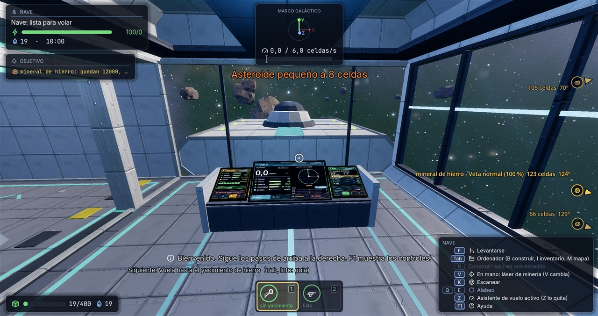
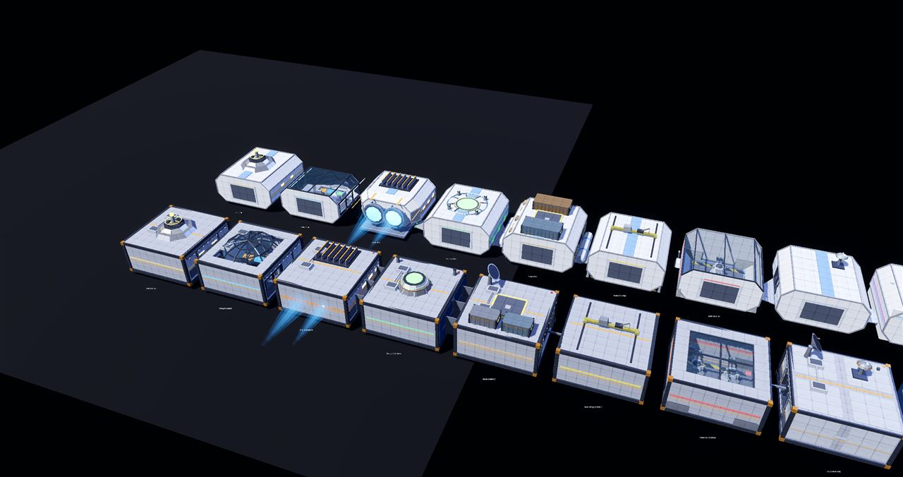
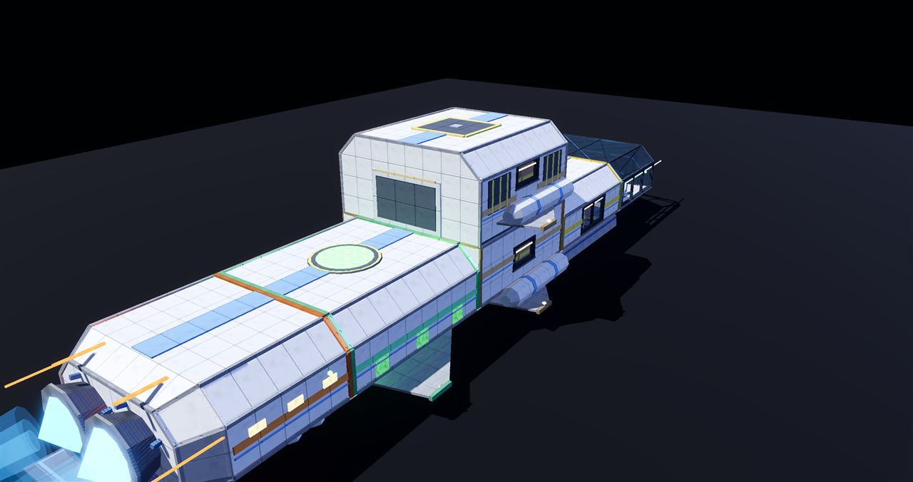
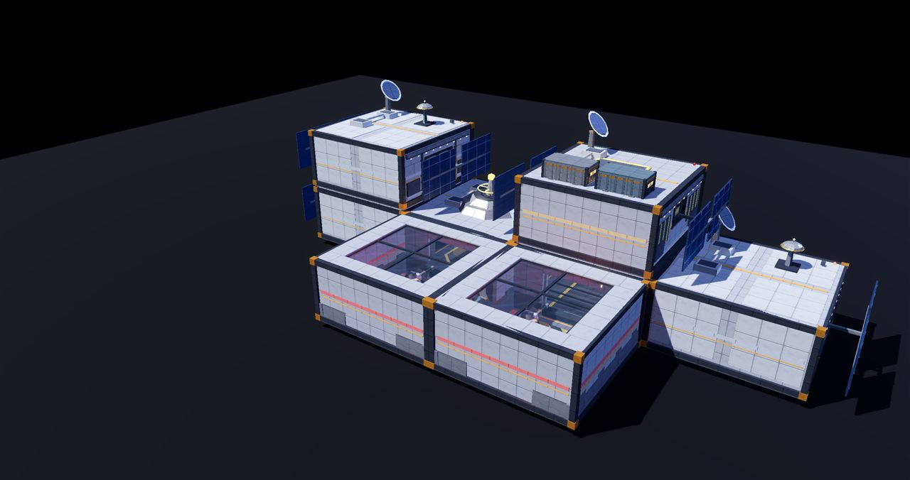
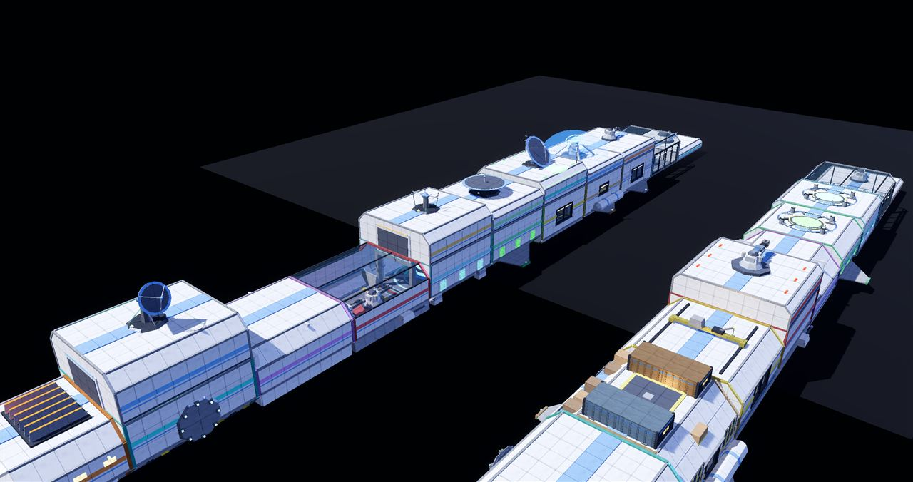

# Visual pass: rocks and space environment

Status: done (2026-11-26), first slice of the 3D visual pass. Everything here is generated by our own code: no third-party file was added, so `ASSETS.md` and `credits.tsv` are unchanged ([ADR 0037](../adr/0037-external-assets-policy.md)). Numbers are *measured* unless marked *proposal*. There is no simulation change and no log version.

## What changed

### Resource rocks (`Models.BuildRock`, `Models.RockPoint`, `DepositView`)
- **Silhouettes are less sphere-like.** Every rock is now an icosphere shaped by a ridged-noise crease term, flat cuts (planes that shave facets), per-rock elongation and, on big rocks, craters with a raised lip. The shape never leaves `Models.RockMaxRadius` (1.9 model units), so the sphere collision of ADR 0033 still holds: `--measure-models` gives an obstacle rock max of 1.83 x nominal radius (was 1.82) and a mean of 1.12 (was 1.17); deposit rocks are at or below the old numbers (iron, initial 4000: max 1.76, was 1.85).
- **Four size classes** (`DepositView.SizeClass`, from the scale the simulation gives the rock): small (under 0.7) are long thin shards with four cuts; medium (under 1.1) lumpy potatoes; large (under 1.8) faceted with two craters; huge are flat-sided slabs with four craters, built one subdivision finer (1,280 triangles instead of 320).
- **Density reads on the rock.** Veins in the ore colour are painted on the surface (`Models.VeinDistance`; the width goes 0.014, 0.03, 0.055 with the poor, normal and rich buckets) and rich rocks get glowing vein studs (0, 4 or 11, more on bigger rocks) on top of the chunk count and size that already followed the density. Big rocks carry more but smaller chunks (a huge rock has 2.2 times the chunks at 0.55 times the size), so a huge rich rock is no longer one giant orange pile.
- Cache keys include the size class and the density bucket, so meshes are still shared per (seed, item, class, bucket, step).

### Environment (`Ambience`)
- **Bright stars**: a rare layer of hot-core stars with a soft coloured glow (warm to blue-white) among the fine ones, for depth.
- **Far dust**: a second, sparse emitter (140 motes, about four times bigger than the near ones, dim and slow, in a 280 x 180 x 280 box that follows the camera) behind the existing near dust, so there are layers at different distances. Both dust layers pick up the colour of the system on `Retint` (the near one a little of the sun, the far one the nebula).
- Lighting, exposure, glow, fog and the planets and sun in the sky shader are unchanged: they already read well in the shots below.

### Tools
- `Gallery.tscn --focus=rocks` shows the four size classes at three richnesses (iron and ice), `--focus=deposits` the item looks.

## Before and after

| | Before | After |
| --- | --- | --- |
| Deposit gallery (6 items x 5 states) |  |  |
| Rock field from the seat (bright stars, far dust) |  |  |
| A big rock beside the ship |  |  |

Size classes (columns small, medium, large, huge; rows iron poor, normal, rich, then ice poor, normal, rich):

## Cost
- Meshes are cached and shared; a rock is 320 triangles (1,280 for a huge one) plus at most 40 chunk prisms and 22 studs, all in two draw calls per rock (rock and chunks). A 60-module station is not affected (no module change). The far dust adds one particle system of 140 quads.
- Measured: `--measure-models` runs headless in a few seconds with the new rocks.

## Not done (left for later passes)
- Ship and station module models, machines and belts were reviewed in the gallery (`--focus=modules`, `station-demo`, `ship-big`) and left as they are: the mesh audit stays green and no model change was made, so the audit and the collision shapes are untouched. A next pass could add emissive trims and wear to the plating.
- Skybox, nebula, planets, fog and tonemapping: kept; see above.
- `--focus=rocks` and the vein width are *proposal* values tuned by eye on a 1280 x 720 window, not on other monitors.

# Visual pass 2: ship and station modules, machines and belts

Status: done (2026-11-27), second slice of the 3D visual pass (branch `feature/visual-pass-modules`). Everything is generated by our own C# code (no Blender export this time, no third-party file), so `ASSETS.md` and `credits.tsv` are unchanged ([ADR 0037](../adr/0037-external-assets-policy.md)). There is no simulation change and no log version: every new piece stands on the roof or the outside of a wall, nothing is walkable or solid, and `HullProfile` (the shells and fixtures the walking body uses) is untouched. This supersedes the "Not done" note above about modules, machines and belts.

## What changed
The modules were readable only by their colour band; from outside every ship section was the same white tube and every station module the same grey box. The new pass (`game/ModuleModels.Exterior.cs`, called once from `ModuleModels.Build`) gives each kind a silhouette:

| Kind | New exterior |
| --- | --- |
| Cargo | Two corrugated containers clamped to the roof (colour by variant, trim-colour band, role-colour door plates, lock bars). A station's sit on the rear half, clear of the hatch. |
| Reactor, Reactor Mk2 | Ship: a ring main with eight cooling spokes round the hatch and four exhaust stacks with a lit tip. Station: a cooling tower (fin ring, lit top plate, two stub stacks). |
| Engine | A radiator on the roof (six tall fins with a lit orange edge) and new nozzles: 16-sided bells with a gimbal collar, three flaring stages, cooling rings, a dark throat and a heat ring (were 10-sided cones). |
| Workshop | A gantry crane on the roof: rails, end trucks, cross beam, trolley with a lit cab, jib and a hanging hook. |
| Core | A crown: octagonal drum with buttresses, gold band, spire with a lit orb and a halo ring, so the heart of a station is its tallest part. |
| Hull | Roof clutter by variant: a radome on a mast, a pair of vent boxes with a duct, or a pair of banded tanks. |
| Dock (ship) | A raised capture ring: eight clamps with a lamp each and a bevelled flange round every collar. |
| Turrets (defence deck, gun, heavy gun) | Armoured mantlet, counterweight, sight block with a lens, two ammo drums; twin barrels get jackets and cooling slots; the heavy barrel gets recoil cylinders, a slotted muzzle brake and a shell hopper. The `Head` / `Barrel` pivots and the barrel reach are unchanged, so aiming is the same. |
| Station walls | On every open flank of a hull, workshop, reactor, core and cockpit: a cornice with a row of lights and conduits with brackets, between the viewports and the louvres. |
| Machines | The shared plinth gets four corner bolts, a hazard strip on the back edge and a data plate with a lit tag on each flank, so every machine reads as one family. |
| Belts | A bracket plate on the outer face of each rail (a long run reads as bolted sections); hubs get a bolt ring and flow ribs. |

Consistent with the rocks and sky pass: the same plating and structural materials, the module palette (`Panel`, `Slab`, `Steel`, role colours) and the emissive material of the lamps; the lit pieces are separate `GlowStrip` meshes so the power dimming still applies.

Before and after, `Gallery.tscn` at 1280 x 720 (`visual/<name>-before.jpg` and `-after.jpg`):

## Checks and cost
- `Gallery.tscn --focus=<layout> --audit=all` (layouts `ship-starter`, `ship-row`, `ship-big`, `ship-tower`, `ship-skins`, `station-demo`): the holes audit stays at 0 sky and 0 seen from outside, the glass audit at 0, the floating pieces equal the base (5, 14, 25, 9, 134, 22: older lamps, strobes and drones, not part of this pass) and the coplanar pairs equal the base (30 on `ship-starter`; the new parts were moved off the planes of the hatch and the roof skin until the audit stopped listing them). Walkable volumes were not touched.
- `--audit` now also prints `AUDIT budget meshInstances=... trianglesPerModule=...`.
- Triangles (audit, whole layout, before to after): ship-starter 14,756 to 18,176 (+23 percent), ship-row 55,802 to 64,018 (+15 percent), ship-big 48,088 to 56,800 (+18 percent), ship-skins (114 modules) 273,834 to 327,930 (+20 percent). Mesh instances per module after the pass: 13.6 to 18.2 (about two more than before: one plain `Hardware` and one lit `GlowStrip` mesh per module, three on a dock). A 60-module station is therefore about 150,000 triangles for the modules (2,000 to 2,900 each) in 800 to 1,100 mesh instances, all from meshes shared per module kind and neighbour mask.
- The belt tile grew by 24 triangles (the bracket plates).

## Not done
- The cockpit interior, the workbench and the floors were reviewed and left alone (the pilot view and the walkable volumes must not get worse; the workbench already reads well). Ship flank greebles (the white tube sides) and a different silhouette per section skin would need `HullProfile` changes; a next pass could do them together with the audit.
- The Blender pipeline was not used: the new parts are boxes, prisms and rings that the builder makes in a few lines; the glb route is better for organic or very detailed parts.
- Checked only on a 1280 x 720 window on the primary monitor, and with the default (non-low) texture quality; the frame cost was not measured.
