# Visual pass: rocks and space environment

Status: done (2026-11-26), first slice of the 3D visual pass. Everything here is generated by our own code: no third-party file was added, so `ASSETS.md` and `credits.tsv` are unchanged ([ADR 0037](../adr/0037-external-assets-policy.md)). Numbers are *measured* unless marked *proposal*. There is no simulation change and no log version.

## What changed

### Resource rocks (`Models.BuildRock`, `Models.RockPoint`, `DepositView`)
- **Silhouettes are less sphere-like.** Every rock is now an icosphere shaped by a ridged-noise crease term, flat cuts (planes that shave facets), per-rock elongation and, on big rocks, craters with a raised lip. The shape never leaves `Models.RockMaxRadius` (1.9 model units), so the sphere collision of ADR 0033 still holds: `--measure-models` gives an obstacle rock max of 1.83 x nominal radius (was 1.82) and a mean of 1.12 (was 1.17); deposit rocks are at or below the old numbers (iron, initial 4000: max 1.76, was 1.85).
- **Four size classes** (`DepositView.SizeClass`, from the scale the simulation gives the rock): small (under 0.7) are long thin shards with four cuts; medium (under 1.1) lumpy potatoes; large (under 1.8) faceted with two craters; huge are flat-sided slabs with four craters, built one subdivision finer (1,280 triangles instead of 320).
- **Density reads on the rock.** Veins in the ore colour are painted on the surface (`Models.VeinDistance`; the width goes 0.014, 0.03, 0.055 with the poor, normal and rich buckets) and rich rocks get glowing vein studs (0, 4 or 11, more on bigger rocks) on top of the chunk count and size that already followed the density. Big rocks carry more but smaller chunks (a huge rock has 2.2 times the chunks at 0.55 times the size), so a huge rich rock is no longer one giant orange pile.
- Cache keys include the size class and the density bucket, so meshes are still shared per (seed, item, class, bucket, step).

### Environment (`Ambience`)
- **Bright stars**: a rare layer of hot-core stars with a soft coloured glow (warm to blue-white) among the fine ones, for depth.
- **Far dust**: a second, sparse emitter (140 motes, about four times bigger than the near ones, dim and slow, in a 280 x 180 x 280 box that follows the camera) behind the existing near dust, so there are layers at different distances. Both dust layers pick up the colour of the system on `Retint` (the near one a little of the sun, the far one the nebula).
- Lighting, exposure, glow, fog and the planets and sun in the sky shader are unchanged: they already read well in the shots below.

### Tools
- `Gallery.tscn --focus=rocks` shows the four size classes at three richnesses (iron and ice), `--focus=deposits` the item looks.

## Before and after

| | Before | After |
| --- | --- | --- |
| Deposit gallery (6 items x 5 states) | 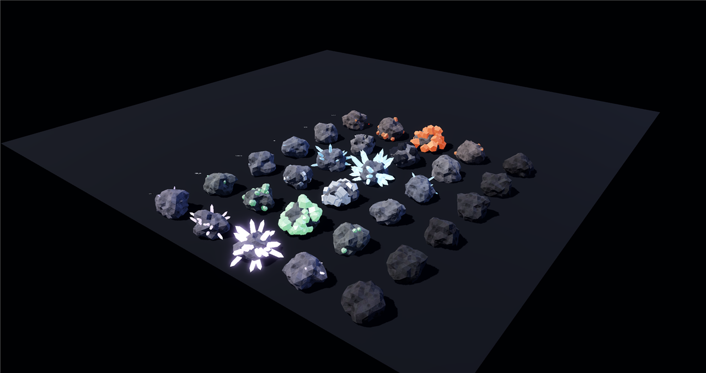 |  |
| Rock field from the seat (bright stars, far dust) |  |  |
| A big rock beside the ship |  | 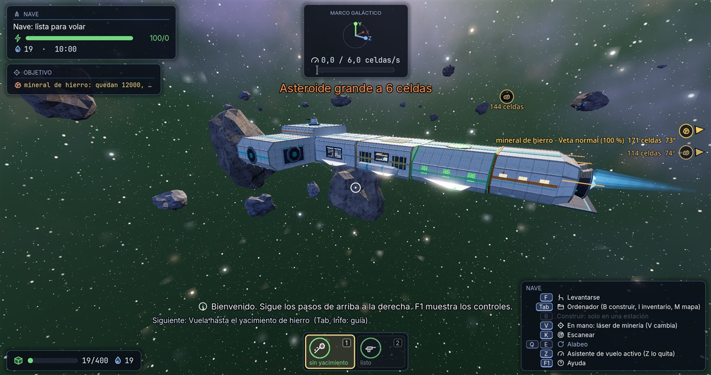 |

Size classes (columns small, medium, large, huge; rows iron poor, normal, rich, then ice poor, normal, rich):

## Cost
- Meshes are cached and shared; a rock is 320 triangles (1,280 for a huge one) plus at most 40 chunk prisms and 22 studs, all in two draw calls per rock (rock and chunks). A 60-module station is not affected (no module change). The far dust adds one particle system of 140 quads.
- Measured: `--measure-models` runs headless in a few seconds with the new rocks.

## Not done (left for later passes)
- Ship and station module models, machines and belts were reviewed in the gallery (`--focus=modules`, `station-demo`, `ship-big`) and left as they are: the mesh audit stays green and no model change was made, so the audit and the collision shapes are untouched. A next pass could add emissive trims and wear to the plating.
- Skybox, nebula, planets, fog and tonemapping: kept; see above.
- `--focus=rocks` and the vein width are *proposal* values tuned by eye on a 1280 x 720 window, not on other monitors.

# Visual pass 2: ship and station modules, machines and belts

Status: done (2026-11-27), second slice of the 3D visual pass (branch `feature/visual-pass-modules`). Everything is generated by our own C# code (no Blender export this time, no third-party file), so `ASSETS.md` and `credits.tsv` are unchanged ([ADR 0037](../adr/0037-external-assets-policy.md)). There is no simulation change and no log version: every new piece stands on the roof or the outside of a wall, nothing is walkable or solid, and `HullProfile` (the shells and fixtures the walking body uses) is untouched. This supersedes the "Not done" note above about modules, machines and belts.

## What changed
The modules were readable only by their colour band; from outside every ship section was the same white tube and every station module the same grey box. The new pass (`game/ModuleModels.Exterior.cs`, called once from `ModuleModels.Build`) gives each kind a silhouette:

| Kind | New exterior |
| --- | --- |
| Cargo | Two corrugated containers clamped to the roof (colour by variant, trim-colour band, role-colour door plates, lock bars). A station's sit on the rear half, clear of the hatch. |
| Reactor, Reactor Mk2 | Ship: a ring main with eight cooling spokes round the hatch and four exhaust stacks with a lit tip. Station: a cooling tower (fin ring, lit top plate, two stub stacks). |
| Engine | A radiator on the roof (six tall fins with a lit orange edge) and new nozzles: 16-sided bells with a gimbal collar, three flaring stages, cooling rings, a dark throat and a heat ring (were 10-sided cones). |
| Workshop | A gantry crane on the roof: rails, end trucks, cross beam, trolley with a lit cab, jib and a hanging hook. |
| Core | A crown: octagonal drum with buttresses, gold band, spire with a lit orb and a halo ring, so the heart of a station is its tallest part. |
| Hull | Roof clutter by variant: a radome on a mast, a pair of vent boxes with a duct, or a pair of banded tanks. |
| Dock (ship) | A raised capture ring: eight clamps with a lamp each and a bevelled flange round every collar. |
| Turrets (defence deck, gun, heavy gun) | Armoured mantlet, counterweight, sight block with a lens, two ammo drums; twin barrels get jackets and cooling slots; the heavy barrel gets recoil cylinders, a slotted muzzle brake and a shell hopper. The `Head` / `Barrel` pivots and the barrel reach are unchanged, so aiming is the same. |
| Station walls | On every open flank of a hull, workshop, reactor, core and cockpit: a cornice with a row of lights and conduits with brackets, between the viewports and the louvres. |
| Machines | The shared plinth gets four corner bolts, a hazard strip on the back edge and a data plate with a lit tag on each flank, so every machine reads as one family. |
| Belts | A bracket plate on the outer face of each rail (a long run reads as bolted sections); hubs get a bolt ring and flow ribs. |

Consistent with the rocks and sky pass: the same plating and structural materials, the module palette (`Panel`, `Slab`, `Steel`, role colours) and the emissive material of the lamps; the lit pieces are separate `GlowStrip` meshes so the power dimming still applies.

Before and after, `Gallery.tscn` at 1280 x 720 (`visual/<name>-before.jpg` and `-after.jpg`):

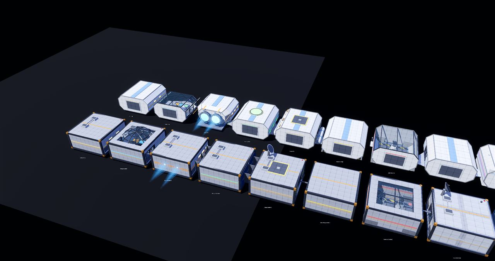

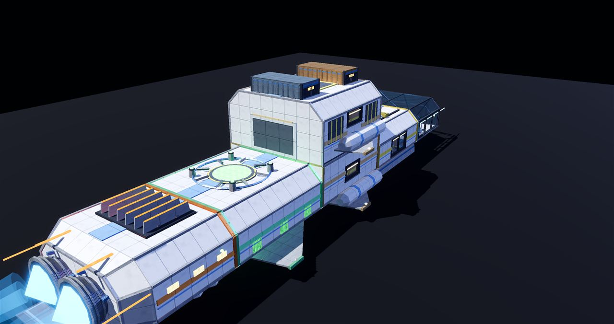
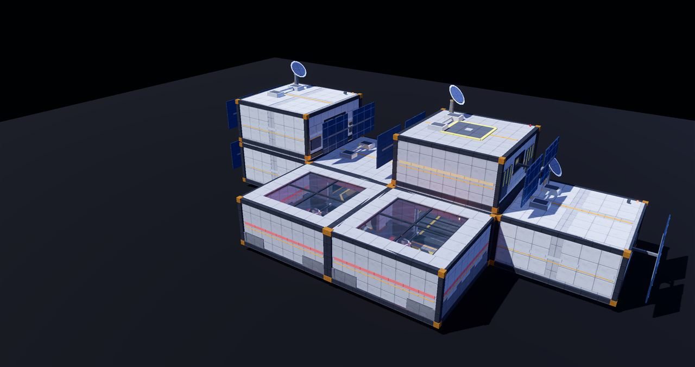

## Checks and cost
- `Gallery.tscn --focus=<layout> --audit=all` (layouts `ship-starter`, `ship-row`, `ship-big`, `ship-tower`, `ship-skins`, `station-demo`): the holes audit stays at 0 sky and 0 seen from outside, the glass audit at 0, the floating pieces equal the base (5, 14, 25, 9, 134, 22: older lamps, strobes and drones, not part of this pass) and the coplanar pairs equal the base (30 on `ship-starter`; the new parts were moved off the planes of the hatch and the roof skin until the audit stopped listing them). Walkable volumes were not touched.
- `--audit` now also prints `AUDIT budget meshInstances=... trianglesPerModule=...`.
- Triangles (audit, whole layout, before to after): ship-starter 14,756 to 18,176 (+23 percent), ship-row 55,802 to 64,018 (+15 percent), ship-big 48,088 to 56,800 (+18 percent), ship-skins (114 modules) 273,834 to 327,930 (+20 percent). Mesh instances per module after the pass: 13.6 to 18.2 (about two more than before: one plain `Hardware` and one lit `GlowStrip` mesh per module, three on a dock). A 60-module station is therefore about 150,000 triangles for the modules (2,000 to 2,900 each) in 800 to 1,100 mesh instances, all from meshes shared per module kind and neighbour mask.
- The belt tile grew by 24 triangles (the bracket plates).

## Not done
- The cockpit interior, the workbench and the floors were reviewed and left alone (the pilot view and the walkable volumes must not get worse; the workbench already reads well). Ship flank greebles (the white tube sides) and a different silhouette per section skin would need `HullProfile` changes; a next pass could do them together with the audit.
- The Blender pipeline was not used: the new parts are boxes, prisms and rings that the builder makes in a few lines; the glb route is better for organic or very detailed parts.
- Checked only on a 1280 x 720 window on the primary monitor, and with the default (non-low) texture quality; the frame cost was not measured.

# Visual pass 3: hull curves (ships and stations)

Status: done (2026-11-27), third slice of the 3D visual pass (branch `feature/hull-curves`). The owner found ships and stations "very square". Everything is generated by our own C# code (no third-party file, `ASSETS.md` and `credits.tsv` unchanged, [ADR 0037](../adr/0037-external-assets-policy.md)). There is **no simulation change and no log version**: the grid rules, `HullProfile.Clear` (the walkable volumes) and the hit volumes (oriented module boxes, [ADR 0030](../adr/0030-ship-attitude-in-the-simulation.md)) are untouched. True new shapes (corner, wedge, round and sloped modules) need the sim and are specified, not built, in the [hull shapes spec](../superpowers/specs/2026-11-27-hull-shapes-design.md) (step B, for the owner to approve).

## Diagnosis
- A ship section is already an octagon (`HullProfile.Octagon`: four walls and four 45 degree chamfers), but a faceted tube reads as a box from a distance; the wings were flat rectangles and the engine tail ended in a flat plate with two nozzles stuck to it.
- A station module is a slab box (`BoxShell`) in a square frame; every outer edge and corner is 90 degrees.
- Because every module is an 8 x 4 x 8 cell box in the sim, the *visible hull may only get smaller than the box* (the hit volume is the box) and the *walkable volume must not change*. So this pass only removes material from corners that cannot be walked in, adds material between a chamfer and the box corner it cut (inside the box), and adds thin attachments that already were allowed to leave the box (wings, masts, solar arrays).

## What changed
| Where | Change |
| --- | --- |
| Ship section (`ModuleModels.Round.cs`, `RoundedShoulders`) | Every chamfer that exists gets a **rounded shoulder**: a quadratic arc from the wall to the roof (or the floor) with the cut corner as control point, tangent to both, so the section reads as a rounded rectangle. It bulges half way from the chamfer to the box corner (about 0.25 cell on a 1 cell chamfer). A side that touches another module is squared and has no chamfer, so the smoothing follows the neighbours by itself: stacked, side by side and tapered sections (nose, tail) all get it; glass canopy edges do not. Strips are capped only at free ends and where they are the fuller of two different strips, so no two caps lie back to back in a joint. |
| Ship wings (`SweptWing`) | A tapered plate with a raked tip (was a rectangle with a stepped end), a trim-colour strake that blends the root into the hull, and a **canted winglet** at the tip with a lit end. Same footprint as before. |
| Ship engine | A **boat-tail cowl** (a 16-sided frustum, 1.27 to 0.97 radius) round each nozzle where it leaves the tail plate, so the bell blends into the hull instead of poking out of a flat plate. |
| Station roof (`BevelCap`, `StationBevel`) | The roof edge of every **exposed side** of a hull, cargo, reactor, Mk2 reactor and core module is cut at 45 degrees (0.7 cell, `HullProfile.StationRoofBevel`): the walls of that side stop at 3.18 cells, a hollow sloped cap (outer skin plus ceiling) rises to the flat roof, and two exposed sides meet in a hip. A side that touches a module keeps its square edge, so modules still meet flush; a module with another on top has no roof. The cornice drops between the window frames and the wall top, the roof strobe and the containers moved clear of the slope, and the raised wall panels, roof accent line and roof plates are clipped to what is left. |
| Station frame | The twelve square beams are now **round tubes with ball nodes** (same twelve edges, never beyond the box); under a roof chamfer the top rail of an exposed side runs along the foot of the slope and a tube follows each hip diagonally. |
| Station solar arrays | A **diagonal strut** from the wall up to the boom. |

Not changed: workshop, defence and drone bay stations (glass roofs and open decks: their roof frames are plain boxes still), the cockpit interior, the walkable shells, machines and belts.

## Collision and walkable volumes
- **Ships**: the shoulders are *outside* the hull section the body walks in (the liner) and inside the module box. `HullShouldersTests` sweeps every ship section (3 roof heights, 8 skins, 16 neighbour combinations, plain, nose and tail scales: more than 1,000 shoulders, 21 points each) and asserts that each point is inside the module box, outside the liner (`HullProfile.InsideSection` false) and on the outer side of its chamfer, that the middle of the arc is half way from the chord to the corner, and that the arc leaves the wall and the roof tangentially. The arc itself lives in `HullProfile.ShoulderPoint` (engine-free) and the model builder calls it, so the test and the drawing cannot drift. `HullProfile.Clear` and `shell.json` (the Blender pipeline's input) did not change.
- **Stations**: the cut starts at `Roof - 0.7` = 3.18 cells, above the head of the body (`BodyHeight` 1.8 plus a full cell) and above the viewport frames (2.84), so `Clear` has nothing to change; a test pins `Roof - StationRoofBevel >= BodyHeight + 1` and that the flat part of the roof (6.32 cells) still carries the roof hardware. **Conservative rule, documented**: where the visible hull is smaller than the box (the roof edge of a station), the hit volume stays the full box, so a ship may touch the sim box where the picture shows a bevel, never the other way round. The wings, winglets, solar struts and masts are thin attachments outside the box, as before (visible and not solid).
- `--blueprint-check` (176 checks) passes on the new models; `--blueprint-shot` shows the ghosts (green, red, yellow and the hatch) as readable as before: they are the same meshes under an overlay, so the shoulders and the roof bevel simply come along. Note for step B: the editor builds its parts with `ModuleModels.Build(kind, ship: true, ...)`, so a *station* in the editor is drawn with ship hulls, not with the station boxes.

## Before and after
`Gallery.tscn` at 1280 x 720 (`visual/hull-<name>-before.jpg`, `-after.jpg`).

| | Before | After |
| --- | --- | --- |
| Starter ship | 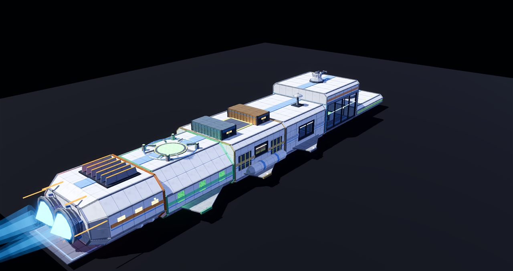 | 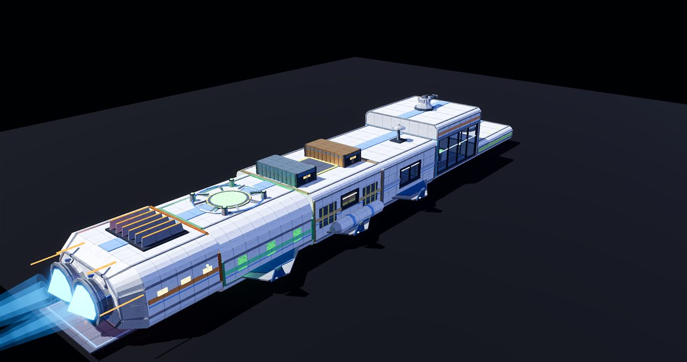 |
| Big ship (stacked and side modules, squared joints) | 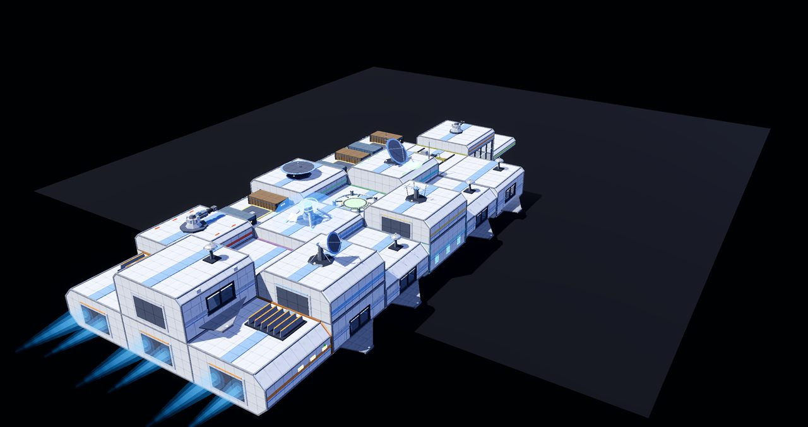 | 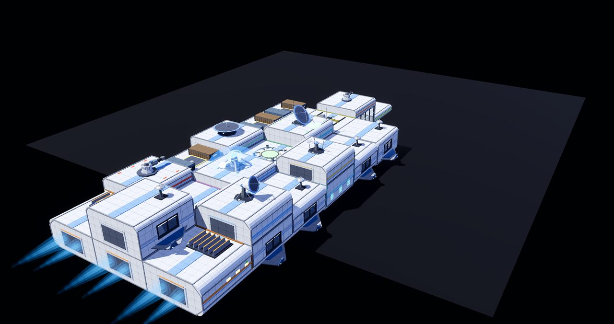 |
| Ship with a nose cockpit | 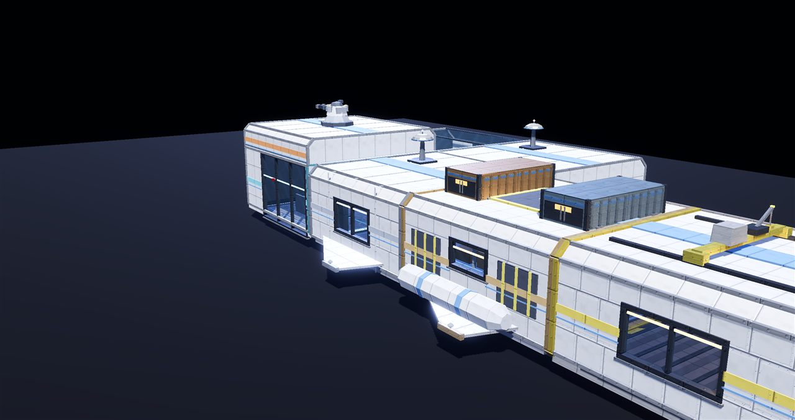 | 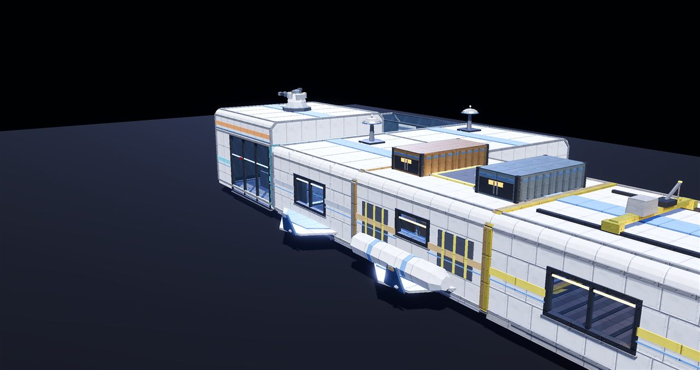 |
| Two rows of every body kind |  | 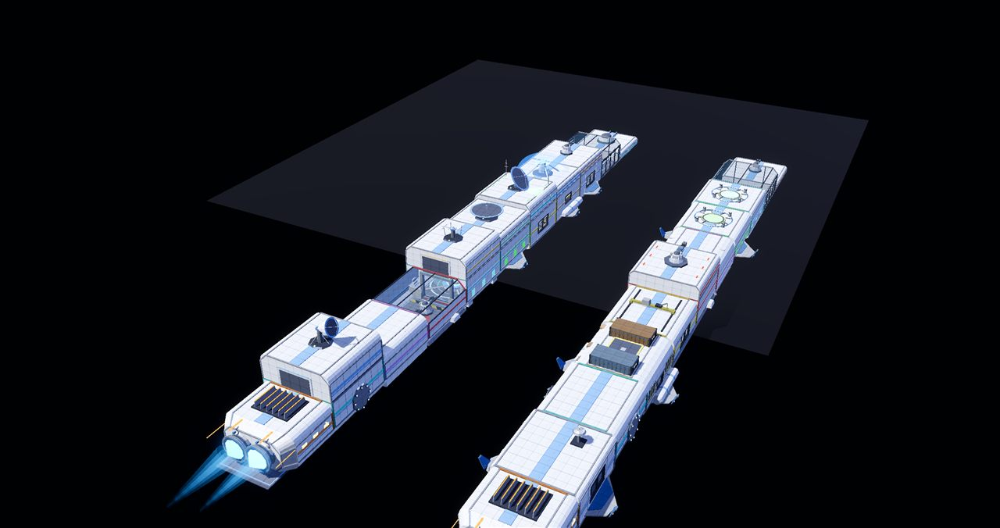 |
| Station | 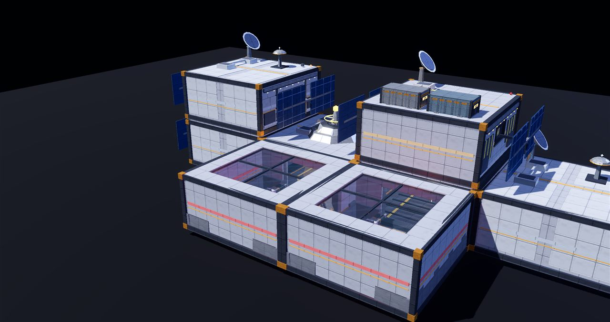 | 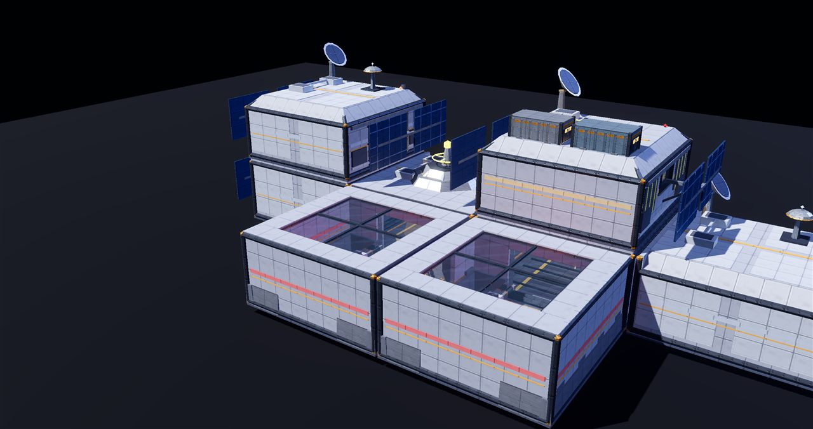 |

## Checks and cost
`Gallery.tscn --focus=<layout> --audit=all`, before to after:

| Layout | Triangles | Per module | Holes (sky, seen from outside) | Floating | Coplanar pairs | Glass | Walk (body parts) |
| --- | --- | --- | --- | --- | --- | --- | --- |
| ship-starter (7) | 18,176 to 18,660 (+2.7 %) | 2,597 to 2,666 | 0, 0 (both) | 5 to 5 | 30 to 31 | 0 | 0 to 0 |
| ship-row (29) | 64,018 to 65,406 (+2.2 %) | 2,208 to 2,255 | 0, 0 (both) | 14 to 14 | 81 to 83 | 0 | 1 to 1 |
| ship-big (28) | 56,800 to 57,789 (+1.7 %) | 2,029 to 2,064 | 0, 0 (both) | 25 to 25 | 76 to 78 | 0 | 3 to 3 |
| station-demo (8) | 23,240 to 26,280 (+13 %) | 2,905 to 3,285 | 0, 0 (both) | 22 to 18 | 62 to 41 | 0 | 7 to 7 |
| ship-skins (114) | 327,930 to 336,236 (+2.5 %) | 2,877 to 2,949 | 0, 0 (both) | 134 to 134 | 48 to 48 | 0 | 1 to 1 |

The extra coplanar pairs on the ships are small overlaps at the wing root (the strake and the winglet against the plate, a few square centimetres inside the hull). The mesh instances per module did not change (16.3, 14.4, 13.6, 17.5, 18.2). The isolated-module layout `--focus=modules` (no neighbours, so it has open joints by design) keeps its baseline holes (2,978 and 2,911 before, 2,961 and 2,591 after: fewer). **A 60-module station**: about 3,285 triangles per module, so about 197,000 (was about 174,000, +13 %), in the same number of draw calls; a 60-module ship is about 2,260 per module, about 136,000. The frame tubes and nodes cost about 900 triangles per station module, the roof cap about 100.

## Scale review
Measured numbers (cells; the sim unit is 1/240 cell): module 8 x 4 x 8; body 1.8 tall, eye 1.7; ceiling liner about 3.78 (2.1 times the body); doorway 3.6 wide (2 times the body) and 2.7 (station) or 3.1 (ship) tall, so 1.5 to 1.7 times the body; the starter ship is 40 long (48 with the laser pod in front), 8 wide and 4 tall (5.2 with the gun deck), a 5 : 1 tube; a mining laser reaches 10 or 14 cells. Rocks: a deposit's nominal radius is 1.3 cells at scale 1 (0.8 to 2.1 over the size range) and the drawn rock reaches 1.83 times that, so at most 3.8 cells; `asteroid_small` has a nominal radius of 1.5 to 3.5 cells and `asteroid_big` 4.5 to 9 (hit radius 155 percent, up to 14).

Findings:
1. **The ship dwarfs the rocks.** A deposit rock (about 3 to 7 cells across) is smaller than one module (8 wide), and a small asteroid is about one module; only `asteroid_big` (9 to 18 across, 28 as a hit sphere) is bigger than the ship is wide. Mining "a rock beside the ship" reads as picking a stone off a runway.
2. **The corridor is a cathedral for the body.** A 3.9 cell ceiling over a 1.8 cell body, and doorways 2 body widths across, make every interior look empty; the 8 cell module is also 4.4 body heights wide.
3. **The 5 : 1 tube** is the main reason ships read as long boxes; the sim only allows the line (a cockpit, then modules, then engines), but a wider footprint (side modules, wings of cargo) fixes it in the editor.
4. The door height differs between a ship and a station (3.1 and 2.7); the door frames are drawn and not solid, so this is cosmetic.

**Applied (client only): none to the dimensions.** Every proportion the client owns is tied to a collision number: `EyeHeight` and `BodyHeight` to `HullProfile.Clear`, the roof to the liner and `shell.json`, the module box to the hit volumes, and a rock's model to its hit radius (ADR 0033). The safe part of the review was the silhouette above, which keeps every one of those numbers.

**Sim-level proposals (listed, not done; each changes content or hashes and needs an ADR and a log version):**
- Raise `DepositRules.BaseRockRadiusUnits` (312, 1.3 cells) by 1.5 to 2 times and retune the clearances of world generation (`WorldGenRules`), so a rock is at least one module wide and the ship stops dwarfing it; the model radius, hit percent and the laser ranges all follow.
- Lower the module height (`StationGrid.ModuleY` 4) to 3, or keep 4 and add a half-height module kind (step B); either one touches every shell number, the stairwell and the Blender shell.
- Widen the ship's footprint by default (a starter ship with two cargo wings) rather than shrink it.

# Visual pass 3: items and building models

Status: done (2026-11-27, branch `feature/items-and-build-models`). Everything is generated by our own C# code (`ItemModels`, `ItemPile`, `ItemPreview`), so `ASSETS.md` and `credits.tsv` are unchanged ([ADR 0037](../adr/0037-external-assets-policy.md)); no Blender export was needed. No simulation change and no log version: only the client draws differently. The hull and module exteriors, the rock field, the lighting and the sim files were not touched, and no machine footprint changed (the machine builders keep their one-cell plinth; a size parameter was not added because it needs the footprint work of `feature/multicell-machines`).

| Before | After |
| --- | --- |
| 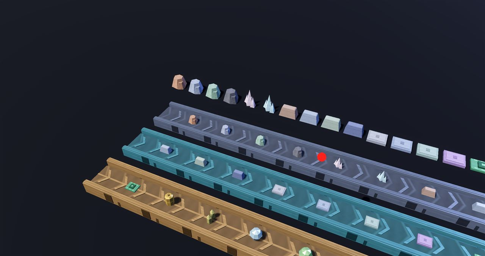 | 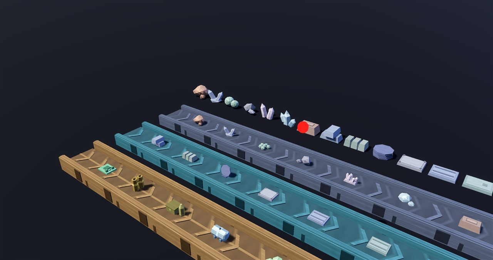 |

## Items
- **24 shapes, 3 variants each** (72 shared meshes, 8,222 triangles in all, 114 on average, 234 at most) in place of 9 flat shapes. Every kind has its own silhouette: iron ore is an angular lump, titanium ore a shard cluster, nickel ore round nodules, carbon coal, quartz and resonant crystals clusters (the resonant one inside a ring), ice a glassy chunk, ingots stepped bars, plates thin riveted sheets, silicon a wafer, circuits a green board with chips and pins, carbon fibre a bundle of rods, composite plate a ribbed slab, titanium alloy a banded billet, fuel cells a glass-and-metal cell with a glowing core, ammo shells, hydrogen a gas bottle, coolant a jug, biomass a pod, the three science packs a gear, a flask and an atom, and the focus lens a ringed lens. An unknown item is a crate.
- **Materials by family** (`Materials.ItemMetal/ItemPlastic/ItemGlass/ItemGlow`, ore and crystal from the existing sets): metal, ore (rough, matte), coal, crystal, glass and ice (transparent with a rim), plastic and composite, and emissive cores that take the item tint. One mesh carries up to two surfaces; the tint of the item is the instance colour, so a shared mesh still reads as iron or titanium.
- **Variants are deterministic**: a belt picks the variant from the segment and the item (`ItemModels.VariantFor`), so an item never changes look while it moves; a pile picks them from the stack id. Flat things (bars, plates, boards) lie along the belt (a yaw from the belt direction).
- **On the ground** (`ItemPile`): a dropped stack or a chunk out of a rock is a little pile of the item's own model, 1 piece for one item up to 6 for sixty or more, with a deterministic turn and variant per piece (flat things stack in layers). One MultiMesh per variant, so a pile is at most 3 draw calls (it was one box or sphere). Chunks loose in space bob and turn.
- **Belts and budgets**: items still go through shared MultiMeshes (`ItemLayers`), one per (shape, variant) per structure, created on demand. Item instances and per-frame writes are unchanged; the mesh layers a structure can use grew from 9 to at most 72 (about a dozen to twenty in a normal factory, since only the items on its belts count), each with a mesh of 114 triangles on average. `Gallery.tscn --focus=items` prints the triangles of every shape.
- **Icons match the models**: the item icons of `IconCatalog` use new glyphs where the 3D shape differs from the old generic one (`oreShard`, `oreNodule`, `iceChunk`, `rods`, `slab`, `jug`, `canister`, `pod`, `lens`, `resonant`; the biology pack uses the flask), so the icon, the belt item and the ground pile say the same thing ([ui-icons](ui-icons.md)).
- **In-hand preview**: the inventory tooltip of a slot (also used by the machine and workbench slots) shows a small turning 3D view of the item beside its text (`ItemPreview`, `InventorySlot.TooltipFor`).

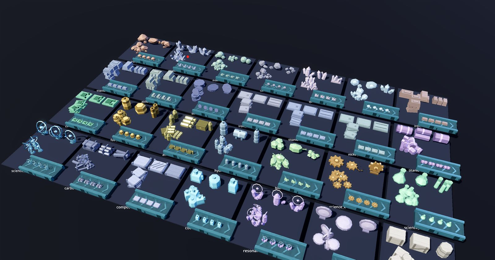

## Building models
- **Build menu**: the detail pane now shows a turning run of three belt tiles of the chosen tier carrying five items, so belts no longer fall back to a flat icon (machines and modules already had their model).
- **Turret**: ammo crates with lid latches and a belt of rounds, a turret ring with four lugs under the head, armoured cheeks, rear radiator vents and a rangefinder on the roof. The head and barrel pivots and the animation are unchanged.
- **Wall**: a centre rib and two riveted armour panels on each face, and a row of rivet heads along the top plate; the collision and the lamps are unchanged.
- Machines, belts and splitter hubs were reviewed again in the gallery and left alone: the shared plinth, the hazard strips and the data plates of the previous pass already read as one family.

| Before | After |
| --- | --- |
|  | 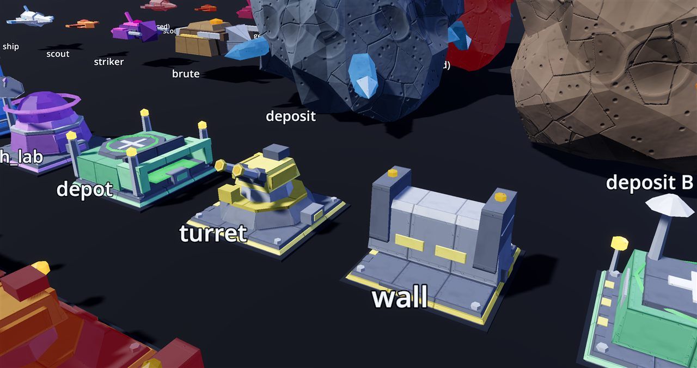 |

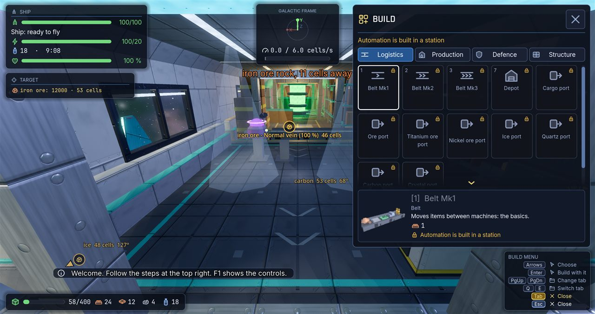
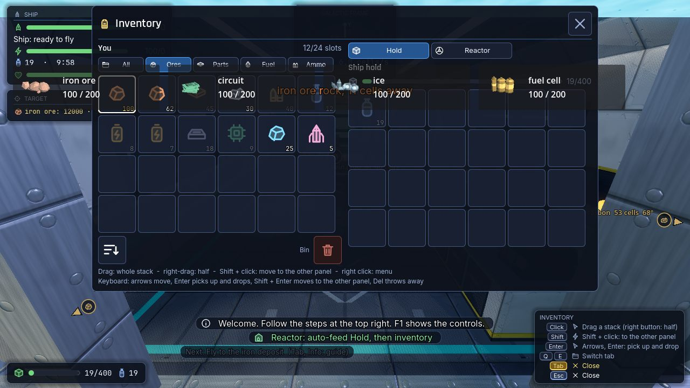

## How to check
`Gallery.tscn --focus=items` (every item: three variants, a pile and a short belt run), `--focus=belts`, `--focus=machines`; `Play.tscn -- --inventory-shot=path` also saves `path.1280x720.en.tooltip.png`; `--ui-shot=path` saves the build menu (`path.build.logistics.png`).

## Not verified
Dropped piles were checked in the gallery only (not in a long play session), the tooltip preview was drawn in a test frame and not through a real mouse hover (no input automation was used), and the Spanish text of the tooltip is the existing one. The old ground crate and the new pile were not measured against each other in frame time.
