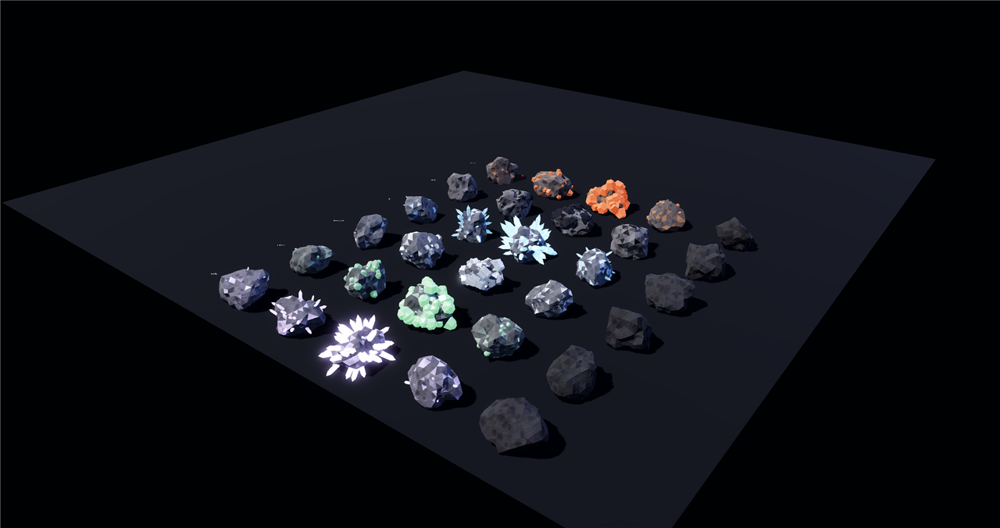
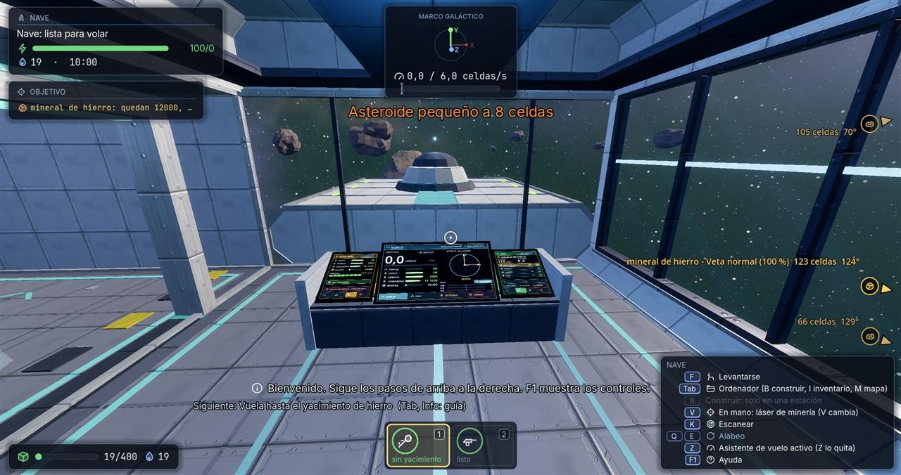
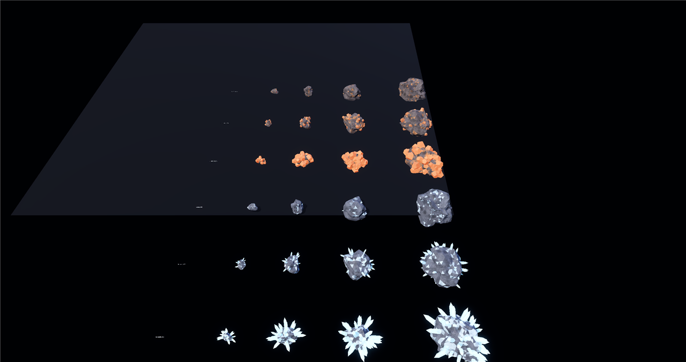

# Visual pass: rocks and space environment

Status: done (2026-11-26), first slice of the 3D visual pass. Everything here is generated by our own code: no third-party file was added, so `ASSETS.md` and `credits.tsv` are unchanged ([ADR 0037](../adr/0037-external-assets-policy.md)). Numbers are *measured* unless marked *proposal*. There is no simulation change and no log version.

## What changed

### Resource rocks (`Models.BuildRock`, `Models.RockPoint`, `DepositView`)
- **Silhouettes are less sphere-like.** Every rock is now an icosphere shaped by a ridged-noise crease term, flat cuts (planes that shave facets), per-rock elongation and, on big rocks, craters with a raised lip. The shape never leaves `Models.RockMaxRadius` (1.9 model units), so the sphere collision of ADR 0033 still holds: `--measure-models` gives an obstacle rock max of 1.83 x nominal radius (was 1.82) and a mean of 1.12 (was 1.17); deposit rocks are at or below the old numbers (iron, initial 4000: max 1.76, was 1.85).
- **Four size classes** (`DepositView.SizeClass`, from the scale the simulation gives the rock): small (under 0.7) are long thin shards with four cuts; medium (under 1.1) lumpy potatoes; large (under 1.8) faceted with two craters; huge are flat-sided slabs with four craters, built one subdivision finer (1,280 triangles instead of 320).
- **Density reads on the rock.** Veins in the ore colour are painted on the surface (`Models.VeinDistance`; the width goes 0.014, 0.03, 0.055 with the poor, normal and rich buckets) and rich rocks get glowing vein studs (0, 4 or 11, more on bigger rocks) on top of the chunk count and size that already followed the density. Big rocks carry more but smaller chunks (a huge rock has 2.2 times the chunks at 0.55 times the size), so a huge rich rock is no longer one giant orange pile.
- Cache keys include the size class and the density bucket, so meshes are still shared per (seed, item, class, bucket, step).

### Environment (`Ambience`)
- **Bright stars**: a rare layer of hot-core stars with a soft coloured glow (warm to blue-white) among the fine ones, for depth.
- **Far dust**: a second, sparse emitter (140 motes, about four times bigger than the near ones, dim and slow, in a 280 x 180 x 280 box that follows the camera) behind the existing near dust, so there are layers at different distances. Both dust layers pick up the colour of the system on `Retint` (the near one a little of the sun, the far one the nebula).
- Lighting, exposure, glow, fog and the planets and sun in the sky shader are unchanged: they already read well in the shots below.

### Tools
- `Gallery.tscn --focus=rocks` shows the four size classes at three richnesses (iron and ice), `--focus=deposits` the item looks.

## Before and after

| | Before | After |
| --- | --- | --- |
| Deposit gallery (6 items x 5 states) |  |  |
| Rock field from the seat (bright stars, far dust) |  |  |
| A big rock beside the ship |  |  |

Size classes (columns small, medium, large, huge; rows iron poor, normal, rich, then ice poor, normal, rich):

## Cost
- Meshes are cached and shared; a rock is 320 triangles (1,280 for a huge one) plus at most 40 chunk prisms and 22 studs, all in two draw calls per rock (rock and chunks). A 60-module station is not affected (no module change). The far dust adds one particle system of 140 quads.
- Measured: `--measure-models` runs headless in a few seconds with the new rocks.

## Not done (left for later passes)
- Ship and station module models, machines and belts were reviewed in the gallery (`--focus=modules`, `station-demo`, `ship-big`) and left as they are: the mesh audit stays green and no model change was made, so the audit and the collision shapes are untouched. A next pass could add emissive trims and wear to the plating.
- Skybox, nebula, planets, fog and tonemapping: kept; see above.
- `--focus=rocks` and the vein width are *proposal* values tuned by eye on a 1280 x 720 window, not on other monitors.
