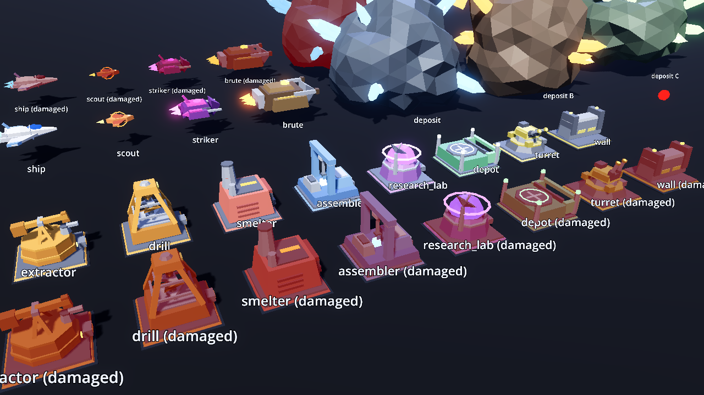

# Prototype P11: walls and repairs

Status: done, awaiting a human play-test (2026-11-20). Decision: [ADR 0011](../adr/0011-walls-draw-enemies-and-repairs-restore-hit-points.md) (proposed). Builds on the [wave ramp](wave-ramp.md).



## What it adds
| Area | Change |
| --- | --- |
| Content | Machine role `wall` and `core:wall`: 400 hit points, 12 ingots and 4 plates, signature 0 (it does not call waves), no recipe, no belts |
| Simulation | Enemies attack the nearest wall of their system before anything else; `Repair(machine)` restores full hit points (campaign: in building range, half the build cost scaled by the damage, at least one of each item); `Reject.NotDamaged`; `WallsLost` counter apart from `MachinesLost` |
| Game | Wall in the build bar (key `0`, the bar now has ten items), a wall model, a **Repair** button with the number of damaged machines in reach (key `E`, one `Repair` per machine, worst first, what the hold cannot pay stays damaged), a repair button in the inspector with its cost, status and tooltip texts in es and en |
| Balance simulator | `--walls=N` (up to four, in the corners around the base, rebuilt when lost) and `--repairs=never|betweenwaves|always` |

```powershell
dotnet run --project tools/Starfoundry.Balance -- --delay=15 --observe=300 --minutes=400 --turrets=1 --walls=4 --repairs=always
```

## Results
First machine lost, as the wave number (1 is the first wave). One fed turret, 15 s per action, seeds 20261120, 1 and 2.

| Defence | First loss |
| --- | --- |
| No walls | 9, 12, 11 |
| One wall, repaired all the time | 12, 16, 15 |
| Four walls, never repaired | 15, 19, 16 |
| Four walls, repaired between waves | 17, 19, 16 |
| Four walls, repaired all the time | 28, 21, 26 |
| Three fed turrets and four walls, repaired all the time | 36, 33, 30 |

With 600 hit points the same walls held longer still (26 to 28 waves with one turret); 400 keeps walls strong without making one turret enough.

## Findings along the way
- Walls matter because enemies stop to shoot the nearest one while turrets kill them; the effect is large (a wall has three to four machines' hit points for about the price of one).
- Repairing between waves barely helps over not repairing: most of the value is repairing a wall while it is being shot, which asks for attention and items. That is the main skill difference the scripted player shows.
- The bot first placed all walls at once and collided with its own script (a cell already taken); a reminder that maintenance (put a lost wall back, repair) has to be tracked per wall.

## Targets pinned by tests
One fed turret, seeds 20261120 and 1: four walls hold at least 3 waves longer than none without any repair; four walls repaired during the fights hold at least 8 waves longer than none and at least 2 longer than the same walls never repaired. Unit tests cover the role (no recipe, no belts, hit points, quiet), the decoy rule (nearest wall first, one wall for a whole wave, machines again when there is none), wall losses counted apart and the cell freed, repair (free in sandbox, cost formula, no items, too far, undamaged, unknown, command codec, exact replay). 305 tests.

## Known limitations
- Nobody has played it by hand: the repair key and button, the build bar with ten items and the wall model were seen in screenshots of the bot-driven demos only; repair during a real fight has not been tried.
- A wall does not block movement or shots, it only draws fire; walls far from the turrets only delay.
- The scripted player repairs everything every second, which a person will not; the "always" row is an upper bound.
- No automatic repair, shields or ship repairs.
