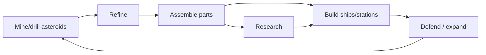

# 01 Core loop

Status: proposal. Numbers are starting points to be tuned in the prototype.

## Loop layers
1. **Seconds:** aim, mine, collect, place a machine, connect a belt.
2. **Minutes:** get a line producing something useful, fix its bottleneck.
3. **Hour:** finish a research tier, unlock a ship or station module, expand to a new asteroid cluster.
4. **Session arc:** build an automated chain, defend against a Remnant wave, open a new system.
5. **Campaign:** progress through four tiers of technology and reach the capstone (a flagship ship plus a system-spanning supply network).

## Opening sequence (first 30 minutes)
1. Spawn on the tug *Halcyon* (one cargo hold, one mining laser, one onboard micro-refinery) in an asteroid belt.
2. Scan, mine iron-bearing and carbon-bearing rock by hand; the micro-refinery makes ingots slowly.
3. Build the first **anchor** (a minimal station core) from starter parts.
4. Place a drill rig, a smelter and a printer; belt them together; produce the first **research datum**.
5. Research the first node (power grid, belts v1), unlock the assembler and the second hold.

## Resource flow overview

## Player verbs
Scan, mine, haul, place, connect, blueprint, research, design (ship/station), command fleet, trade, fight, explore.

## Pacing rules
- The first three minutes need no tutorial text beyond contextual hints.
- A new mechanic is introduced at most every 20 to 30 minutes of play.
- Every research tier introduces one new logistics constraint (for example fluids at tier 2, heat at tier 3).
- Threat waves never arrive before the player has a first weapon and a way to build a turret.

## Failure and recovery
- Ship destroyed: respawn at the nearest anchor, lose cargo in transit only, ship wreck recoverable for 30 minutes.
- Station damaged: machines go offline, never deleted; repair with materials.
- No hard fail state. Difficulty settings scale threat frequency and resource richness.

## Open questions
See [12-open-questions](12-open-questions.md) (tier count, tutorial format).
