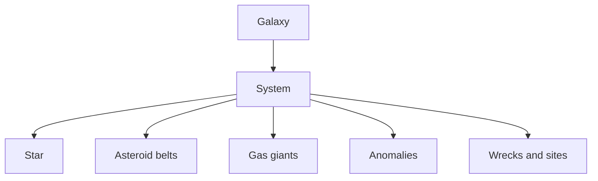

# 04 World and exploration

Status: proposal. Reference states procedurally generated systems with unique logistic challenges, wrecks, new resources, black holes, neutron stars, NPC traders.

> **Implementation status:** only the ship in a single empty region exists so far ([world and ship](../prototypes/world-and-ship.md)): integer positions, a fixed starter field of deposits, mining and build ranges. Systems, procedural generation, scanning, wrecks and travel between systems are still design only.

## Structure
Galaxy map of **systems**, each generated from a seed. Each system contains a star, bodies (asteroid belts, planetoids, gas giants, ice fields) and optional anomalies. Systems are connected by **lanes** discovered by scanning.

## Generation
- Seed = galaxy seed + system index. Same seed gives the same system for every player (co-op safe).
- Each system picks an **archetype** that defines its logistics challenge: dense belt (short hauls), sparse belt (long hauls), gas-rich (fluid logistics), radiation storm (shielding), tight orbit (heat), rogue (no sun, power from fuel only).
- Star type sets solar power, temperature zones, and which resources exist (data-driven weights).

## Resource tiers
| Tier | Examples (illustrative) | Where |
| --- | --- | --- |
| 1 | iron ore, carbon, ice | Home belt |
| 2 | copper, silicon, hydrogen | Home system, outer belt |
| 3 | titanium, rare isotopes, exotic gas | Other systems |
| 4 | Remnant alloy, neutron-star matter | Anomalies and Remnant sites |

## Movement
- **In-system:** assisted flight. Free flight near stations and bodies; long legs use autopilot "burn" with a visible time. Ships have no fuel for basic thrust in the MVP (TBD).
- **Between systems:** jump drive (tier 3 research) along discovered lanes; jump cost in fuel and charge time.

## Scanning
Active scanner reveals deposits in a cone and range; passive scanner marks anomalies. Scan results are persistent map data. Richness is shown as a colour band, not exact numbers.

## Points of interest
- **Wrecks:** loot containers and a short puzzle (power the door, route a cable) that yields blueprints and rare parts.
- **Derelict stations:** claimable, with a ruined module graph the player can repair.
- **Anomalies:** black hole (gravity well hazard, energy source later), neutron star (extreme heat and rare matter), nebula (sensor noise).
- **Remnant sites:** guarded vaults and nodes of the sentinel network (see [06-threats-combat](06-threats-combat.md)).

## NPCs and trade
Small, scripted outposts offering trade and contracts. Early scope: buy and sell a fixed list of items at rates that shift with supply. Factions are post-MVP.

## Persistence
Visited systems are stored as seed plus a delta list (player-built entities, depleted deposits). The world is never regenerated from scratch.

## Open questions
Galaxy size, lane graph shape, finite vs regenerating asteroid belts. See [12-open-questions](12-open-questions.md).
