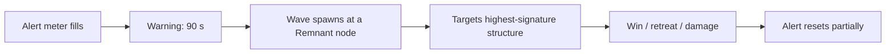

# 06 Threats and combat

Status: proposal. Reference states: an ancient alien defence network detects industry, sends waves, you defend or strike first, endgame battleship, trade with NPCs. Our implementation is original.

> **Implementation status:** a first version exists ([threat and combat](../prototypes/threat-and-combat.md), [ADR 0008](../adr/0008-remnant-threat-as-signature-driven-waves.md)): machine signatures, a per-system alert meter, warned waves of two enemy types, machine hit points, ammo-fed turrets and an armed ship. Heat and power as signature sources, stealth and quiet-play modules, decoys, fleets with orders, assaults on Remnant nodes, shields and damage types are still design only.

## The Remnant
Dormant automated sentinels left by a vanished civilisation. They are tuned to heat and power signatures above a **threshold** and respond with waves of drones.

## Detection model (the core design hook)
- Each build volume and ship emits a **signature** = heat + power output + radio traffic.
- A system has a **Remnant alert** meter. Signature above the local threshold raises alert; below it, alert decays.
- Players choose between **loud and fast** (high output, frequent waves) and **quiet and slow** (radiators, shielding, stealth modules, lower output).
- Alert thresholds trigger waves; they are never random timer spam.

## Waves

- Warning time (default 90 s, scales with difficulty) shown with direction and strength.
- Wave composition scales with alert level and tier: scouts, strikers, bombers, then heavy "bastion" drones.
- Players can **pre-empt**: destroy the Remnant node that spawns the wave (a timed assault with a boss-like guardian).

## Defence options
| Option | Notes |
| --- | --- |
| Fixed turrets | Station modules; cheap, powered, fed ammo by belts |
| Fleet | Frigates on patrol or assigned to a station |
| Shields and armour | Passive resistance, repairable by drones |
| Decoys | Cheap high-signature beacons that draw attacks away from the factory |
| Quiet play | Lower signature and radiators |

## Combat model
- Mostly assisted, first-person flight with turret and gimbal weapons; not a twitch dogfight sim.
- Damage types: kinetic, thermal, EM; armour and shields resist differently.
- Ship AI for fleet: orders (escort, patrol, hold, attack target), formations optional (TBD).
- Friendly fire off in co-op by default.

## Enemy archetypes (illustrative)
| Archetype | Role |
| --- | --- |
| Scout drone | Probes, weak, attracts waves if it escapes |
| Striker | Fast, low HP |
| Bomber | Targets machines |
| Lancer | Long range |
| Bastion | Tanky, shielded |
| Warden | Guardian of a node |

## Endgame
The capstone battleship (see [03-ship-station-builder](03-ship-station-builder.md)) enables an assault on the **core node** of a system and unlocks Remnant alloy.

## Difficulty
Threat frequency, wave size, warning time, and resource richness are independent sliders. A **peaceful** option turns waves into optional raids.

## Open questions
Wave interaction with multiple players' stations, whether quiet play can fully avoid waves. See [12-open-questions](12-open-questions.md).
