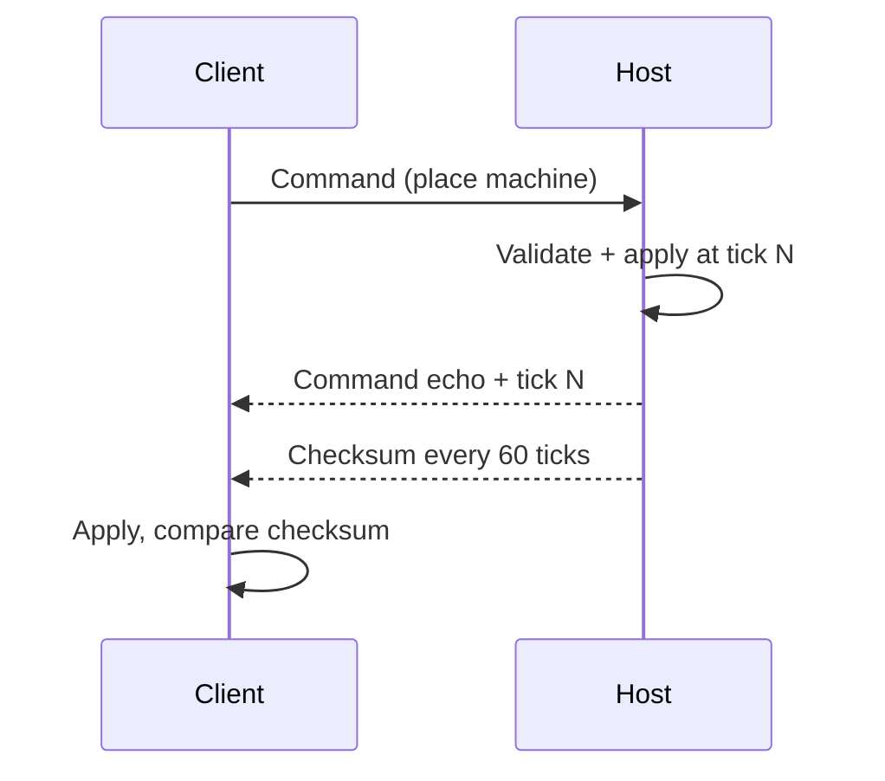

# 07 Multiplayer

Status: proposal. Reference: online co-op, each player captains their own ship, roles can be split. Player cap and hosting model are not stated, so these are our decisions.

## Model
- **Host-authoritative co-op**: one player (or a dedicated server later) runs the simulation; clients send inputs and receive state.
- 1 to 4 players in the MVP; target 8 later (TBD, driven by simulation cost).
- Same save format solo and co-op. A solo save can be opened to friends.

## Why lockstep-style determinism
The simulation core is deterministic (ADR 0002). That allows:
- Sending **commands** (place machine, set recipe, issue fleet order) instead of full state for the factory.
- Checksums per N ticks to detect desyncs, with state resync on mismatch.
- Replays and tests from command logs.

Player movement and combat are not lockstep; they use client-side prediction with server reconciliation and are fed into the simulation at tick boundaries.

## Roles
No hard classes. Typical splits: logistics, industry, exploration, defence. Each player has their own ship, cargo and respawn anchor; stations are shared, with optional **ownership flags** per build volume.

## Permissions
Host settings: who can build, who can demolish, who can open the research tree. Default: everyone can do everything.

## Connectivity
- Steam P2P relay or direct connect (engine networking layer, see [09-technical-architecture](09-technical-architecture.md)).
- Drop-in and drop-out: joining receives a snapshot then command stream.
- Host leaves: save and session end in the MVP; host migration is TBD.

## Co-op balance
Resource costs and wave size scale with player count via the difficulty slider, not automatically; the host sets it.

## Anti-cheat and trust
Co-op only among friends; no anti-cheat. The host is the authority; clients cannot spawn items.

## Testing
Headless host plus scripted bot clients that replay command logs in CI.

## Open questions
Dedicated server, cross-play, host migration. See [12-open-questions](12-open-questions.md).
