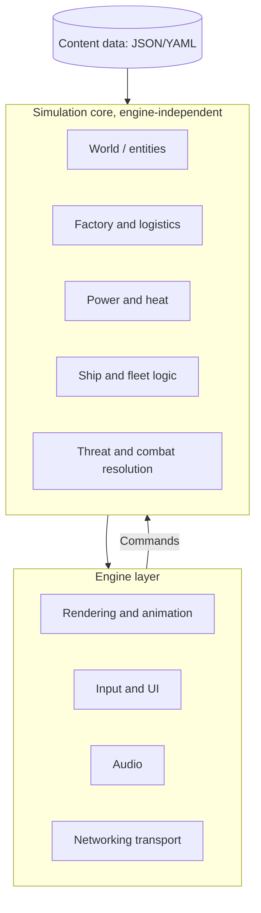

# 09 Technical architecture

Status: proposal, engine pending owner confirmation ([ADR 0001](../adr/0001-engine.md)).

## Goals
- 1,000+ machines and 10,000+ belt items at 30 simulation ticks per second and 60 FPS on the recommended hardware.
- Deterministic simulation for testing, replays and co-op.
- Content as data; code changes only for new mechanics.

## Layers

- **Simulation core:** a pure library with no engine references. Runs headless. Fixed-timestep tick. Integer or fixed-point arithmetic for anything that affects state (ADR 0002).
- **Engine layer:** presents state, collects input, converts it into commands.
- **Data layer:** recipes, machines, modules, research, systems archetypes, loaded and validated at startup.

## Simulation design
- Data-oriented: components in arrays (structure of arrays), systems iterate. Entities identified by stable integer IDs.
- Belts: segments with item slots; an item moves by position along a segment, not as an independent engine object. Rendering reads a compact buffer.
- Spatial partition per build volume; chunking for systems.
- Tick budget: 33 ms total; target under 12 ms for the simulation at the benchmark base.
- Multithreading: independent build volumes and systems tick in parallel; cross-volume transfers resolved in a deterministic merge step.

## Rendering strategy
- Instancing for belts, items and repeated modules.
- LODs for machines, impostors for distant stations.
- Occlusion by build volume; cull inactive systems.
- Stylised, low-poly art to keep draw calls manageable for a solo developer.

## Saves
- Versioned binary format (header, chunked sections, per-system deltas), compressed.
- Migration functions per version bump; test fixtures for every released version.
- Autosave every 5 minutes with 3 rotating backups; async write to avoid hitches.
- Human-readable JSON export for debugging.

## Networking
See [07-multiplayer](07-multiplayer.md). Commands over reliable ordered transport; transport behind an interface so we can use the engine's built-in layer or Steam sockets.

## Tooling
- Content validator CLI (schema checks, referential integrity).
- Balance simulator: headless runs that measure time to milestones.
- Benchmark scenes in CI (headless), with regression thresholds.
- Blueprint and design linter.

## Testing
- Unit tests for belt, power, heat, routes.
- Golden-state tests: run N ticks from a saved scenario and compare a checksum.
- Property tests for conservation (items are never created or lost).
- Playtest builds distributed through Firebase App Distribution or Steam playtest branch.

## Build and release
- CI builds Windows and Linux; artifacts only for the owner. Steam delivery later (owner action).
- Versioning: SemVer for builds, separate save-format version.

## Risks
| Risk | Mitigation |
| --- | --- |
| Performance at scale | Data-oriented sim, benchmarks from week one |
| Desyncs in co-op | Checksums, headless replays, avoid floating-point in state |
| Scope creep | Roadmap gates, non-goals in [00-vision](../00-vision.md) |
| Solo bandwidth | Data-driven content, reuse, small art kit |
