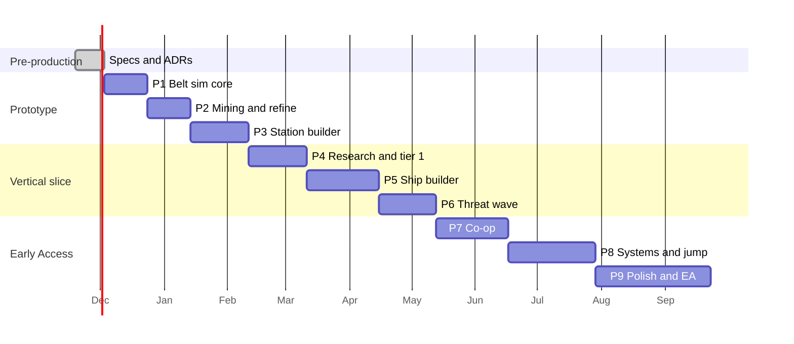

# 11 Roadmap

Status: proposal. Durations assume one developer at part-time pace and are estimates, not commitments.

## Phases and exit criteria

| Phase | Deliverable | Exit criteria |
| --- | --- | --- |
| P0 Pre-production | Specs, ADRs, engine decision, repo | Owner approves ADR 0001 and 0002 |
| P1 Belt sim core | Headless library: items, belts, splitters, power | Unit tests green; benchmark 10k belt items under 5 ms per tick |
| P2 Mining and refine | First-person mining, micro-refinery, hold | Mine to ingot loop playable |
| P3 Station builder | Build volume, machine placement, ghosts, belts in 3D | A player builds a mine-smelt-print line |
| P4 Research and tier 1 | Research lab, nodes, datums, tier 1 content | 2 hours of content, tier 1 complete |
| P5 Ship builder | Module editor, stats, build and fly | Design and fly a hauler; supply route works |
| P6 Threat wave | Remnant alert, one wave type, turrets | Wave warning, defence and a clear result |
| **Vertical slice** | Tiers 1 and 2, one system | 8 hours playable, no soft locks |
| P7 Co-op | Host-authoritative sessions | 4 players, desync checks, join in progress |
| P8 Systems and jump | Generator, archetypes, jump drive, tier 3 | 3 systems, 20 hours |
| P9 Polish and EA | UI polish, tutorial, saves, perf, localisation | EA checklist below |

## Early Access checklist
- [ ] 30 hours content, tiers 1 to 3 plus capstone sketch
- [ ] Save migration tested across versions
- [ ] 1,000-machine benchmark meets targets
- [ ] Spanish and English strings
- [ ] Controller or documented keyboard-only flow
- [ ] Store page, trailer, demo build
- [ ] Crash reporting and in-game feedback channel
- [ ] Owner-only steps done: store account, tax, age ratings, release approval

## Demo strategy
Release a free demo (tier 1, one system, co-op enabled) before Early Access to gather wishlists, as comparable titles did.

## Risks and gates
Each phase ends with a playtest. If the factory loop is not fun after P3, stop and fix it before adding ships or combat.

## Owner decisions needed
Game name, store account, art direction. See [12-open-questions](12-open-questions.md).
