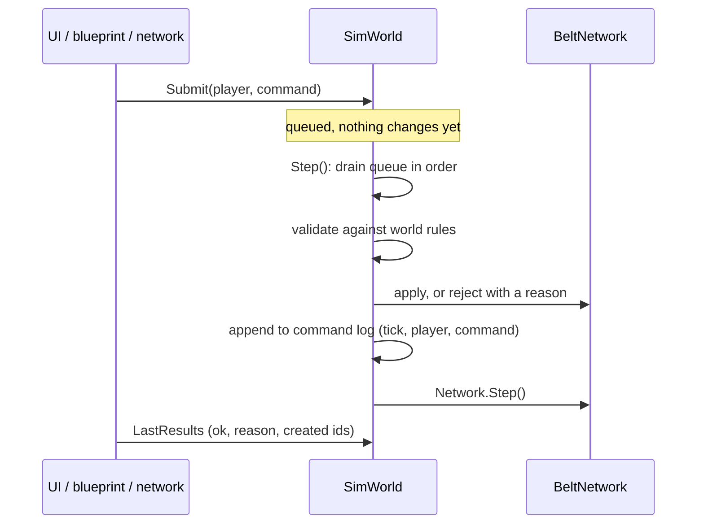

# 13 Command layer

Status: implemented for belts (prototype P1.5); other systems will add commands the same way. Decision: [ADR 0003](../adr/0003-commands-as-the-only-way-to-change-the-world.md).

## Flow

## Commands (belts)
| Command | Effect | Main rejections |
| --- | --- | --- |
| `PlaceSegment(x, y, z, dir, length, tier)` | New straight belt, 1 to 128 cells | InvalidArgument, OutOfBounds (coordinates within 10,000), Overlap, TooManySegments |
| `RemoveSegment(id)` | Removes the belt, destroys its items, detaches neighbours, frees its cells | UnknownSegment |
| `ConnectSegments(from, to)` | End of `from` feeds start of `to`; the first cell of `to` must touch the last cell of `from` by a face (ahead or to a side) | UnknownSegment, SelfConnection, FromIsSink, AlreadyConnected, OutputsFull (2), NotAdjacent |
| `DisconnectSegments(from, to)` | Removes the connection | UnknownSegment, NotConnected |
| `SetSource(id, itemTypes)` / `ClearSource(id)` | Feeds the belt start with a repeating pattern of item types (1 to 64) | UnknownSegment, InvalidArgument |
| `SetSink(id)` / `ClearSink(id)` | Consumes items arriving at the end | UnknownSegment, SinkHasOutputs |
| `Batch(commands)` | Atomic group, no nesting; negative ids (-1, -2, ...) refer to the first, second, ... segment placed earlier in the batch | any of the above, plus NestedBatch; `FailedIndex` says which command failed |

### Machine commands
Need a `SimWorld` created with content ([ADR 0004](../adr/0004-data-driven-content-and-one-cell-machines.md)).

| Command | Effect | Main rejections |
| --- | --- | --- |
| `PlaceMachine(x, y, z, machineType, recipe)` | One-cell machine; recipe -1 for none | NoContent, UnknownMachineType, UnknownRecipe, RecipeMismatch, OutOfBounds, Overlap, TooManyMachines |
| `RemoveMachine(id)` | Destroys its contents, detaches its belts, frees the cell | UnknownMachine |
| `SetRecipe(id, recipe)` | Changes the recipe; buffers and the craft in progress are discarded | UnknownMachine, UnknownRecipe, RecipeMismatch |
| `ConnectToMachine(segment, machine)` | The belt end feeds the machine; the machine cell must touch the belt's last cell by a face | UnknownSegment, UnknownMachine, AlreadyConnected, NotAdjacent, SegmentConflict |
| `ConnectFromMachine(machine, segment)` | The machine feeds the belt start; the belt's first cell must touch the machine cell | as above, plus MachineOutputsFull (2) |
| `DisconnectMachine(segment, machine)` | Removes the link in whichever direction exists | NotConnected |

Inside a batch, negative machine ids refer to machines placed earlier in that batch (-1 first, -2 second), like segment ids. `CommandResult.CreatedMachines` lists the ids created.

### Player and research commands
Act for the commanding player ([ADR 0005](../adr/0005-campaign-economy-hold-costs-and-research-gates.md)).

| Command | Effect | Main rejections |
| --- | --- | --- |
| `StartMining(deposit)` / `StopMining` | Hand-mine a deposit into the hold, 2 ore per second, until the hold is full or the deposit is empty | NoContent, UnknownDeposit, Depleted |
| `SetShipRecipe(recipe)` | What the ship's micro-refinery works on (-1 for nothing); a craft in progress is undone and its inputs returned | UnknownRecipe, NotAShipRecipe, Locked |
| `SetResearch(node)` | The node labs work on (-1 for none); progress is kept per node | UnknownResearch, ResearchUnavailable |
| `LinkDeposit(machine, deposit)` / `UnlinkDeposit(machine)` | Point a drill at a deposit | UnknownMachine, WrongRole, UnknownDeposit |
| `SetMovement(dx, dy, dz)` | Ship movement intent, -1, 0 or 1 per world axis; the ship keeps moving until the next intent ([ADR 0006](../adr/0006-ship-movement-as-intent-commands-and-ranges.md)) | InvalidArgument |

`StartMining` also needs the ship within 6 cells of the deposit (OutOfRange). In campaign mode, placing or removing belts and machines needs the ship within 24 cells (OutOfRange).

In **campaign** mode the build commands also enforce costs and locks: `PlaceSegment` and `PlaceMachine` take their cost from the commanding player's hold (NotEnoughItems), reject locked belt tiers, machines and recipes (Locked), and `RemoveSegment` and `RemoveMachine` refund it. `SetSource` and the free extractor are sandbox only. Ship machine types cannot be placed in the world (NotPlaceable).

## Rules
- Commands apply at the start of the next tick, in submission order. Two commands for the same cell resolve by that order.
- A rejected command changes nothing. A rejected batch restores the world exactly, including id counters.
- Ids are stable and never reused. A removed segment leaves a hole (`IsAlive` is false).
- Items on a removed segment are destroyed and counted in `Destroyed`. Conservation: `Spawned = Consumed + Destroyed + InTransit`.
- Malformed commands (nulls, oversized, nested more than 4 levels in the encoding) throw at `Submit`, because they could never be logged. Game-rule problems are never exceptions.

## Log, codec and replay
- Log header: magic `SFCL`, format version (3), content hash, game mode, entry count. Compare the hash with `ContentDb.Hash` before replaying. A replay starts from a world built the same way as the original (same mode, content and starting deposits and grants).
- `CommandCodec` encodes commands and logs: little-endian, magic `SFCL`, version byte, bounded sizes, strict decoding (unknown tags, truncation, bad order and trailing bytes are errors).
- `SimWorld.Replay(log, ticks)` rebuilds a world from an empty one; the result has the same checksum as the original. Replaying a prefix reproduces intermediate states.
- The checksum covers geometry, wiring, items and counters, so it doubles as the co-op desync check.

## Validation tooling
- `SimWorld.ValidateInvariants()` checks: wiring symmetry (outputs and inputs), no overlapping cells, cell index matches segments, item spacing and ranges, merge and round-robin indices, conservation.
- A fuzz test fires random valid and invalid commands (including batches with references) for 2,500 ticks on five seeds, validates invariants every tick, then replays the log both directly and through the binary format and compares checksums.

## Cost
Atomic batches snapshot the network. Measured on the benchmark scenario: 0.13 ms median for a tick that applies a batch at 10,000 items, 0.38 ms at 100,000 (first call up to 5 ms from JIT). Plain ticks are unaffected.

## Not done yet
- Permissions per player (host settings) and per-build-volume ownership: commands already carry the player id.
- Commands for ships and research (belts and machines are done). Each new gameplay action adds a command, a codec tag, reject reasons and tests.
- Undo and redo, blueprint capture and placement (they build on `Batch`).
- Network transport and tick agreement ([07-multiplayer](07-multiplayer.md)).
- A targeted undo journal to replace the batch snapshot if batches become frequent or worlds much larger.
